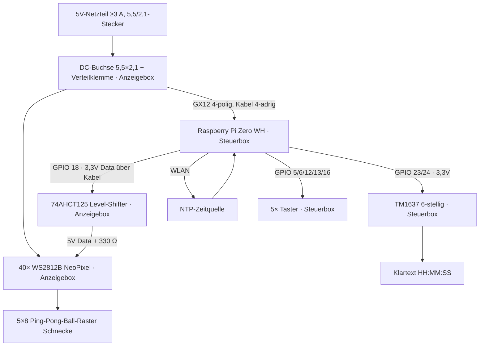
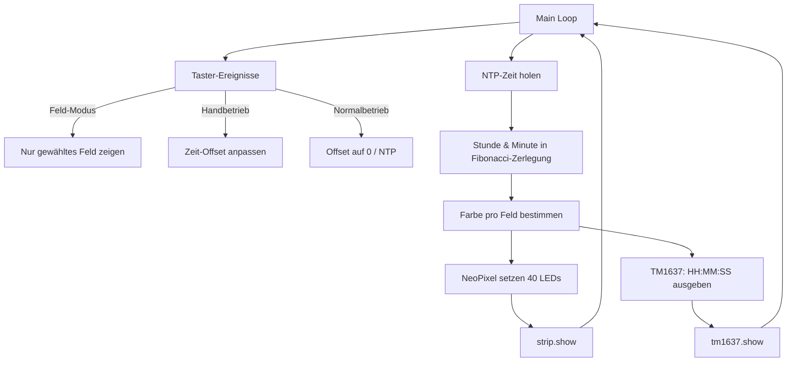

# 🏓 Fibonacci Ping-Pong-Ball-Uhr – Bauanleitung & Entwurf

> Bauanleitung von Paul Simmen, erstellt mit Vibe (GLM-5-2), überarbeitet 20./21.10.2026.
> Eine Fibonacci-LED-Uhr mit 40 Ping-Pong-Bällen im hochkanten 5×8-Raster
> (sich öffnende Fibonacci-Schnecke), gesteuert durch einen Raspberry Pi Zero WH,
> mit zusätzlichem 0,36″ TM1637 6-stelligem LED-Display als Klartext-Anzeige
> und fünf Tastern für Feld-Durchschaltung, Handbetrieb und Normalbetrieb.
>
> **Aufbau in zwei Gehäusen:** **Steuerbox** (Pi, Taster, TM1637-Anzeige) und
> **Anzeigebox** (Lochplatte mit Bällen, NeoPixel, Level-Shifter, Kondensatoren,
> 5V-Anschluss). Versorgungsspannung überall **5V**, Datenleitungen **3,3V**.

---

## 1. Funktionsprinzip (Konfidenz: hoch)

### 1.1 Fibonacci-Verlegung im 5×8-Raster (Schnecke)

Die fünf Fibonacci-Felder (Werte 1, 1, 2, 3, 5) kacheln lückenlos in ein
**hochkantes 5×8-Rechteck** – als **sich öffnende Fibonacci-Schnecke**
(Anordnung wie bei der Nerdiy-/Original-Uhr). Jedes Feld besteht aus mehreren
gleich gefärbten Bällen:

| Feld | Wert | Bälle | Lage (Spalten × Zeilen)  |
|------|------|-------|--------------------------|
| A    | 5    | 25    | Spalten 0–4 × Zeilen 0–4 (oben, volle Breite) |
| B    | 3    |  9    | Spalten 0–2 × Zeilen 5–7 (unten links) |
| C    | 2    |  4    | Spalten 3–4 × Zeilen 6–7 (unten rechts) |
| D    | 1    |  1    | Spalte 3 × Zeile 5 (LED 28) |
| E    | 1    |  1    | Spalte 4 × Zeile 5 (LED 29) |
| **Total** | **12** | **40** | 5×8 = 40 Bälle      |

```
A A A A A
A A A A A
A A A A A
A A A A A
A A A A A
B B B D E     <- D/E nebeneinander = Zentrum der Schnecke
B B B C C     <- C direkt darunter
B B B C C
```

Die Quadrate öffnen sich vom Zentrum nach aussen: **D → E → C → B → A** –
jedes grössere Quadrat umschliesst die kleineren (klassische Fibonacci-Spirale).

### 1.2 Farbcodierung

| Farbe  | Bedeutung                         |
|--------|-----------------------------------|
| rot    | Feld zählt zur Stunde             |
| grün   | Feld zählt zu den Minuten (×5)    |
| blau   | Feld zählt zu Stunde UND Minute   |
| aus    | Feld zählt nicht                  |

### 1.3 Ablesen

- **Stunde** = Summe(rote Felder) + Summe(blaue Felder)
- **Minute** = (Summe(grüne Felder) + Summe(blaue Felder)) × 5

Anzeige bewusst nur **5-Minuten-genau** (wie im Original).

### 1.4 Beispiel 08:10

| Wert | Stunde | Minute |
|------|--------|--------|
| 5    | ja     | –      |
| 3    | ja     | –      |
| 2    | –      | ja     |
| 1    | –      | –      |
| 1    | –      | –      |

→ Stunde = 5+3 = 8, Minute = 2×5 = 10 → **08:10**

Feld 5 (25 Bälle) und Feld 3 (9 Bälle) leuchten **rot**,
Feld 2 (4 Bälle) leuchtet **grün**, die beiden Einer bleiben **aus**.

### 1.5 Zufallszerlegung (setBits)

Für jede Zahl 1–12 gibt es mehrere gültige Fibonacci-Summen. Die Software
wählt per `random()` eine davon → die Uhr sieht bei jedem 5-Minuten-Wechsel
anders aus (keine Mehrdeutigkeit-Auflösung wie bei Base4 nötig; **Konfidenz: hoch**,
übernommen aus der Original-Arduino-Firmware von Philippe Chretien).

---

## 2. Systemübersicht



| Komponente                     | Box        | Funktion                              |
|-------------------------------|------------|---------------------------------------|
| Pi Zero WH                    | Steuerbox  | Steuerung, NTP, Farb- und Zeitlogik   |
| 5× Taster                     | Steuerbox  | Feld-Modus, Handbetrieb, Normalbetrieb |
| TM1637 6-stellig              | Steuerbox  | Klartext HH:MM:SS (VCC 5V, Daten 3,3V) |
| Level-Shifter 74AHCT125       | Anzeigebox | hebt Data-Leitung 3,3V → 5V vor LED 0 |
| 40× WS2812B NeoPixel          | Anzeigebox | Anzeige im 5×8-Ball-Raster (Schnecke)  |
| 1000 µF Elko (+ nF je Modul)  | Anzeigebox | Stabilisierung der LED-Versorgung     |
| 5V-Einspeisung: DC-Buchse 5,5×2,1 (Anzeigebox) | Anzeigebox | gemeinsame 5V-Einspeisung beider Boxen |
| Verbindungskabel 4-adrig + GX12 4-polig | dazwischen | 5V, GND, Data (3,3V), Reserve |

---

## 3. Hardware-Liste

| # | Teil                          | Zweck                          | Richtpreis CHF | Konf. |
|---|-------------------------------|--------------------------------|----------------|-------|
| 1 | Raspberry Pi Zero WH          | Steuerung + WLAN/NTP           | 25.–           | hoch  |
| 2 | MicroSD 8–16 GB               | OS (Bookworm Lite)             | 8.–            | hoch  |
| 3 | 40× WS2812B NeoPixel          | 1 LED pro Ball                 | 15.–           | hoch  |
| 4 | TM1637 0,36″ 6-stellig        | Klartext HH:MM:SS              | 5.–            | hoch  |
| 5 | 5V-Netzteil ≥3 A              | gemeinsame Versorgung beider Boxen (Einspeisung in Anzeigebox) | 20.– | hoch |
| 6 | Level-Shifter 74AHCT125       | 3,3V→5V Datenpegel (in Anzeigebox verbaut) | 3.–      | hoch  |
| 7 | Widerstand 330–470 Ω          | Schutz am LED-Data-In          | <1.–           | hoch  |
| 8 | Elko 1000 µF / 6,3V           | Stabilisierung an der 5V-Einspeisung (Anzeigebox) | 1.– | hoch |
| 9 | 40× Ping-Pong-Bälle           | Diffusor / Anzeige             | 15.–           | hoch  |
| 10| Lochplatte / Brett 5×8        | Ball-Halterung (200×320 mm hochkant) | Bastelkiste | hoch |
| 11| 5× Taster (Öffner, gg. GND)   | Feld-Modus, Handbetrieb, Normalbetrieb | 2.–      | hoch  |
| 12| Jumper-Wires                  | Verdrahtung TM1637 + Taster (Steuerbox) | 2.–   | hoch  |
| 13| Verbindungskabel 4-adrig ≥0,5 mm² | Anzeigebox↔Steuerbox: 5V, GND, Data, Reserve | 5.– | hoch |
| 14| 1 Paar Avionik-Kupplungen GX12, 4-polig (Stecker + Dose) | Verbindungskabel trennbar steckbar | 8.– | hoch |
| 15| DC-Steckerbuchse 5,5×2,1 mm (Einbau, Gewinde) | 5V-Netzteil-Zuleitung in der Anzeigebox | 3.– | hoch |
| 16| 2× Gehäuse                    | Steuerbox + Anzeigebox         | Bastelkiste   | hoch  |

**Geschätzte Gesamtkosten:** ~115 CHF

---

## 4. Verdrahtung

### 4.1 Stromversorgung (5V) & Gehäuseaufteilung

**Prinzip:** Ein gemeinsames 5V-Netzteil versorgt beide Gehäuse. Alle
Datenleitungen laufen mit **3,3V** (Pi-Pegel); erst der 74AHCT125 in der
Anzeigebox hebt die NeoPixel-Datenleitung auf 5V.

```
                          ┌────────── Steuerbox ──────────────────┐
                          │  Pi Zero WH  ·  5× Taster  ·  TM1637  │
                          │  (Pi & TM1637 versorgt mit 5V)        │
                          └───┬───────────────▲────────────────────┘
              5V + GND       │               │  Data 3,3V (GPIO 18)
              (Verbindungskabel 4-adrig)     │
                          ┌───▼──────────────┴───── Anzeigebox ─────┐
 Netzteil 5V/≥3A ───────► │ DC-Buchse 5,5×2,1 ─┬─ 1000 µF Elko (nah dran) │
                          │                     ├─ 40× NeoPixel VCC (5V)   │
                          │                     └─ 74AHCT125 VCC (Pin 14)  │
                          │ 74AHCT125: 1A (Pin 2) ◄── Data 3,3V    │
                          │             1Y (Pin 3) ─[330–470 Ω]─► DIN LED 0
                          │             OE (Pin 1) → GND           │
                          └────────────────────────────────────────┘
```

**Wichtig (Konfidenz: hoch):**
- **Einspeisung in der Anzeigebox:** Das Netzteil wird an der eingebauten
  **DC-Steckerbuchse 5,5×2,1 mm** angeschlossen (Innenpol = **+5V**, Aussenring
  = GND; Netzteil mit Pluspol innen wählen). Dahinter verteilt eine kleine
  Klemme die 5V an NeoPixel-Kette (bis 2,4 A bei Vollelweiss), 1000 µF-Elko
  und Level-Shifter. Über das Verbindungskabel werden zusätzlich die
  Steuerbox-Komponenten versorgt.
- **Verbindungskabel (4-adrig, ≥0,5 mm²):** 5V, GND, Data (3,3V), Reserve –
  getrennt steckbar über ein **Avionik-Kupplungspaar GX12, 4-polig**
  (Stecker an der einen, Dose an der anderen Box; Panelmontage mit
  ⌀-12-mm-Bohrung, Kontermutter und Kabelverschraubung als Zugentlastung).
  Belegung beidseitig identisch: **Pin 1 = 5V, Pin 2 = GND, Pin 3 = Data,
  Pin 4 = Reserve**; das Metallgehäuse des GX12 wird nicht als Leiter
  benutzt (GND läuft über Pin 2). Das Kabel trägt nur den Strom von
  Pi + TM1637 (~0,5 A) – der NeoPixel-Strom bleibt in der Anzeigebox.
  GX12 4-polig ist dafür strommässig weit überdimensioniert (typ. einige A
  pro Pin; Konfidenz: mittel). Die GND-Ader ist zwingend (gemeinsame
  Masse beider Boxen).
- **Kondensatoren:** 1000 µF-Elko direkt an der 5V-Einspeisung der Kette
  (Empfehlung laut WS2812B-Datenblatt). Die China-Einzelmodule haben meist
  zusätzlich je ein 100 nF onboard – siehe `docs/WS2812B_ChinaModul.pdf`.
- **Pi speisen:** 5V-Pin 2/4 direkt von der Steuerbox-Verteilung (Achtung:
  umgeht den Polyfuse) – oder sauberer über ein am 5V-Kabel angeschlossenes
  Micro-USB-Kabel (Schutz des Pi bleibt wirksam).
- **74AHCT125 (in der Anzeigebox):** VCC (Pin 14) = 5V, GND (Pin 7) = Masse,
  OE (Pin 1) → GND (Ausgang dauerhaft aktiv), 1A (Pin 2) ← Data,
  1Y (Pin 3) → [330–470 Ω] → DIN von LED 0. Unbenutzte Gatter: A-Eingänge
  (Pins 5/9/12) und OE (Pins 4/10/13) auf GND legen.
- **Datenblätter** (im Repo unter `docs/`): `WS2812B_ChinaModul.pdf`,
  `TM1637_7SegmentChinaModul.pdf`, `sn54ahct125.pdf`.

### 4.2 NeoPixel (40 LEDs, in der Anzeigebox)

```
Steuerbox                  Anzeigebox
─────────────              ──────────────────────────────────────────────
GPIO 18 (PWM0) ──Kabel──►  74AHCT125 1A (Pin 2, 3,3V-Pegel)
                            74AHCT125 1Y (Pin 3) ──[330–470 Ω]──► DIN (LED 0)
                                              DOUT → DIN(LED 1) → ... → LED 39
5V-Verteiler (DC-Buchse) ──┬────────────►  74AHCT125 VCC (Pin 14, 5V)
            ├────────────►  VCC aller NeoPixel (Einspeisung am Anfang)
GND ────────┴────────────►  GND (74AHCT125 Pin 7 + alle LEDs)
                            + 1000 µF Elko über VCC/GND an der Einspeisung
```

**Wichtig (Konfidenz: hoch):**
- GPIO 18 = PWM0, der klassische Pin für `rpi_ws281x` / Adafruit NeoPixel.
- Die 3,3V-Datenleitung läuft durch das Verbindungskabel bis zum Shifter in
  der Anzeigebox; erst ab 1Y liegt 5V-Pegel an der Kette (Empfehlung laut
  WS2812B-Datenblatt, da VIH der LEDs bei 5V-Versorgung ca. 3,5 V beträgt).
- Bei 40 LEDs ab einer Einspeisung: Spannungsabfall am Ende möglich.
  Falls das ferne Ende farblich „abdriftet" → zweite 5V-Einspeisung am Ende
  (direkt von der 5V-Verteilklemme der Anzeigebox).
- Strom: 40 × 60 mA = 2,4 A (Volleiweiß) → 3A-Netzteil mit Reserve.

### 4.3 TM1637 6-stelliges Display (in der Steuerbox)

```
Pi Zero WH               TM1637 Modul (Steuerbox)
─────────────            ────────────
GPIO 23  ──────────────>  CLK   (Daten 3,3V)
GPIO 24  ──────────────>  DIO   (Daten 3,3V)
5V       ──────────────>  VCC   (aus der 5V-Verteilung der Steuerbox)
GND      ──────────────>  GND
```

**Hinweis (Konfidenz: mittel):**
- Versorgung 5V, Daten 3,3V: Laut TM1637-Datenblatt liegt VIH bei ca.
  0,7 × VDD ≈ 3,5 V – der 3,3V-Pegel des Pi ist damit grenzwertig, funktioniert
  mit den China-Modulen aber praktisch immer (`docs/TM1637_7SegmentChinaModul.pdf`).
  Falls die Anzeige unzuverlässig ist: Modul-Pull-ups entfernen oder das Modul
  mit 3,3V betreiben (Anzeige dann geringfügig dunkler).
- Die 6-stellige Variante ist seltener als die 4-stellige; darauf achten,
  dass das Modul tatsächlich 6 Ziffern hat (Typ: „TM1637 6 digit 0.36″").

### 4.4 Taster (5× Öffner gegen GND, in der Steuerbox)

```
Pi Zero WH                    Taster
─────────────                 ──────────────────────────────────
GPIO 5   ─────────────────>  T1  (Felder A–E durchschalten)
GPIO 6   ─────────────────>  T2  (+1 Minute, Handbetrieb)
GPIO 12  ─────────────────>  T3  (+5 Minuten, Handbetrieb)
GPIO 13  ─────────────────>  T4  (+1 Stunde, Handbetrieb)
GPIO 16  ─────────────────>  T5  (Normalbetrieb / NTP)
GND      ─────────────────>  gemeinsame Masse aller Taster
```

**Hinweis (Konfidenz: hoch):**
- Öffner-Taster: eine Seite an den GPIO, die andere an GND.
- Die internen Pull-Ups des Pi aktiviert `gpiozero` automatisch
  (`Button(..., pull_up=True)` ist Standard) – keine externen Widerstände nötig.
- Entprellung regelt `gpiozero` in Software (`bounce_time`).

### 4.5 Gesamt-Pin-Übersicht

| Pin          | Funktion           | Ziel                                          |
|--------------|--------------------|-----------------------------------------------|
| GPIO 18      | PWM0 / NeoPixel    | Kabel → 74AHCT125 1A → 1Y → [330 Ω] → DIN LED 0 |
| GPIO 23      | CLK                | TM1637 (Steuerbox, Daten 3,3V)                 |
| GPIO 24      | DIO                | TM1637 (Steuerbox, Daten 3,3V)                 |
| GPIO 5       | Taster 1           | Feld-Modus (Steuerbox)                        |
| GPIO 6       | Taster 2           | +1 Minute (Steuerbox)                         |
| GPIO 12      | Taster 3           | +5 Minuten (Steuerbox)                        |
| GPIO 13      | Taster 4           | +1 Stunde (Steuerbox)                         |
| GPIO 16      | Taster 5           | Normalbetrieb (Steuerbox)                     |
| 5V (Pin 2/4) | Strom              | Pi + TM1637 (aus Verbindungskabel)            |
| GND          | Masse              | Alle – gemeinsame Masse beider Boxen          |

Strompfad: Netzteil → DC-Buchse 5,5×2,1 → Verteilklemme (Anzeigebox) → NeoPixel + Shifter direkt,
und über das 4-adrige Verbindungskabel → Steuerbox (Pi 5V-Pin, TM1637 VCC).

---

## 5. LED-Mapping (40 LEDs → 5 Felder)

### 5.1 Verdrahtungsreihenfolge

Empfehlung: LED-Kette in **Schlangenlinie** (Zeile für Zeile, links→rechts,
dann nächste Zeile) verlegen. Dann ist die Formel einfach:

```
LED-Index = Zeile × 5 + Spalte     (Zeile 0–7, Spalte 0–4)
```

Das Raster steht **hochkant**: 5 Spalten (Breite) × 8 Zeilen (Höhe).

### 5.2 Mapping-Tabelle

```python
# Feld-Definition: (Wert, [Liste der LED-Indizes])
# Annahme: Schlangenlinie, Zeile 0 oben links, LED 0 = (0,0)

def led_index(row, col):
    """Schlangenlinie: Zeile für Zeile, links nach rechts."""
    return row * 5 + col

FELDER = {
    5: [led_index(r, c) for r in range(5) for c in range(5)],    # 25 LEDs
    3: [led_index(r, c) for r in range(5,8) for c in range(3)],  #  9 LEDs
    2: [led_index(r, c) for r in range(6,8) for c in range(3,5)],#  4 LEDs
    1: [led_index(5, 3)],                                        #  1 LED (Feld D, LED 28)
    1: [led_index(5, 4)],                                        #  1 LED (Feld E, LED 29)
}
# ACHTUNG: Python-Dictionary kann keine doppelten Keys!
# Besser als Liste von Tupeln:
```

```python
# Korrekt: Liste von (Wert, [LED-Indizes])
FELDER = [
    (5, [r * 5 + c for r in range(5) for c in range(5)]),         # Feld A: 25 LEDs (oben)
    (3, [r * 5 + c for r in range(5, 8) for c in range(3)]),      # Feld B:  9 LEDs (unten links)
    (2, [r * 5 + c for r in range(6, 8) for c in range(3, 5)]),  # Feld C:  4 LEDs (unten rechts)
    (1, [5 * 5 + 3]),                                             # Feld D:  1 LED (LED 28)
    (1, [5 * 5 + 4]),                                             # Feld E:  1 LED (LED 29)
]
NUM_LEDS = 40
```

### 5.3 Verifikation

```python
assert sum(len(feld[1]) for feld in FELDER) == 40  # alle LEDs erfasst
assert sum(feld[0] for feld in FELDER) == 12       # 5+3+2+1+1 = 12
```

---

## 6. Software-Architektur



### 6.1 Bibliotheken

| Bibliothek     | Zweck                        | Installation                     |
|----------------|------------------------------|----------------------------------|
| `rpi_ws281x`   | NeoPixel-Ansteuerung (PWM)   | `pip install rpi_ws281x`         |
| `tm1637`      | TM1637-Display-Ansteuerung   | `pip install raspberrypi-tm1637` |
| `gpiozero`    | Taster (Pull-Up, Entprellung) | vorinstalliert auf Raspberry Pi OS |
| `ntplib`      | NTP-Zeitabfrage              | `pip install ntplib`            |
| `datetime`    | Zeit-Verarbeitung            | Python Standardbibliothek       |
| `time`        | sleep, Zeit-Funktionen       | Python Standardbibliothek       |
| `random`      | Zufallsauswahl setBits       | Python Standardbibliothek       |

---

## 7. Code-Entwürfe

### 7.1 Konfiguration (`config.py`)

```python
"""Konfiguration der Fibonacci Ping-Pong-Ball-Uhr (5×8 Schnecken-Raster)."""

# --- NeoPixel ---
LED_PIN        = 18          # GPIO 18 (PWM0)
LED_COUNT      = 40          # 5×8 Bälle
LED_FREQ_HZ    = 800000      # WS2812-Standard
LED_DMA        = 10          # DMA-Kanal
LED_BRIGHTNESS = 0.4         # 0.0–1.0 (40 Bälle: nicht zu hell!)
LED_INVERT     = False
LED_CHANNEL    = 0
LED_STRIP_TYPE = 0x00081008  # NEO_GRB + NEO_KHZ800 (PRÜFEN!)

# --- TM1637 ---
TM1637_CLK     = 23          # GPIO 23
TM1637_DIO     = 24          # GPIO 24
TM1637_BRIGHTNESS = 4        # 0–7

# --- Taster (gpiozero, gegen GND, interner Pull-Up) ---
BTN_FIELD_PIN = 5            # T1: Felder A–E durchschalten
BTN_MIN_PIN   = 6            # T2: Handbetrieb +1 Minute
BTN_MIN5_PIN  = 12           # T3: Handbetrieb +5 Minuten
BTN_HOUR_PIN  = 13           # T4: Handbetrieb +1 Stunde
BTN_NORM_PIN  = 16           # T5: Normalbetrieb (Offset zurücksetzen)
BTN_BOUNCE_SEC = 0.05        # Prellen abfangen

# --- Farben (R, G, B) ---
COLOR_OFF    = (0,   0,   0)
COLOR_HOURS  = (255, 0,   0)   # rot
COLOR_MIN    = (0,   255, 0)   # grün
COLOR_BOTH   = (0,   0,   255) # blau
COLOR_FIELD  = (255, 255, 255) # weiss (Feld-Durchschaltung)

# --- NTP ---
NTP_SERVER   = "ch.pool.ntp.org"
TIMEZONE     = "Europe/Zurich"

# --- Update ---
UPDATE_INTERVAL_SEC = 10      # alle 10 s aktualisieren
NTP_SYNC_INTERVAL_MIN = 30    # alle 30 min NTP neu synchronisieren
```

### 7.2 LED-Mapping (`mapping.py`)

```python
"""Mapping: 40 physische LEDs → 5 logische Fibonacci-Felder (Schnecke)."""

# Schlangenlinie: LED-Index = Zeile × 5 + Spalte
# Raster hochkant: 5 Spalten (0–4) × 8 Zeilen (0–7)
# Schnecke: D/E (Zeile 5) -> C (Zeilen 6–7) -> B (Zeilen 5–7) -> A (Zeilen 0–4)

FELDER = [
    # (Wert, [LED-Indizes])
    (5, [r * 5 + c for r in range(5) for c in range(5)]),          # A: 25 LEDs (oben)
    (3, [r * 5 + c for r in range(5, 8) for c in range(3)]),       # B:  9 LEDs (unten links)
    (2, [r * 5 + c for r in range(6, 8) for c in range(3, 5)]),   # C:  4 LEDs (unten rechts)
    (1, [5 * 5 + 3]),                                              # D:  1 LED (LED 28)
    (1, [5 * 5 + 4]),                                              # E:  1 LED (LED 29)
]

# Verifikation beim Import
assert sum(len(f[1]) for f in FELDER) == 40, "LED-Anzahl stimmt nicht!"
assert sum(f[0] for f in FELDER) == 12, "Fibonacci-Summe stimmt nicht!"
```

### 7.3 Taster-Steuerung (`buttons.py`)

```python
"""Taster-Steuerung: Feld-Modus, Handbetrieb (Offset), Normalbetrieb."""
from gpiozero import Button
from config import (BTN_FIELD_PIN, BTN_MIN_PIN, BTN_MIN5_PIN,
                    BTN_HOUR_PIN, BTN_NORM_PIN, BTN_BOUNCE_SEC)

MODE_NORMAL = "normal"   # NTP-Zeit, Fibonacci-Anzeige
MODE_MANUAL = "manual"   # Zeitversatz (Offset), Uhr läuft weiter
MODE_FIELD  = "field"    # Feld-Durchschaltung A-E

class ButtonController:
    """
    Fragt die 5 Taster ab (gpiozero, interne Pull-Ups, softwareseitig entprellt).

    Handbetrieb = Offset in Sekunden zur Systemzeit; Taster 5 setzt ihn auf 0.
    on_event(mode, field_idx, offset_sec) wird bei jedem Tasterdruck aufgerufen
    ( gpiozero ruft when_pressed in einem Hintergrund-Thread auf ).
    """

    def __init__(self, on_event):
        self._notify = on_event
        self._mode = MODE_NORMAL
        self._field = -1
        self._offset_sec = 0

        taster = {
            "field": Button(BTN_FIELD_PIN, bounce_time=BTN_BOUNCE_SEC),
            "min":   Button(BTN_MIN_PIN,   bounce_time=BTN_BOUNCE_SEC),
            "min5":  Button(BTN_MIN5_PIN,  bounce_time=BTN_BOUNCE_SEC),
            "hour":  Button(BTN_HOUR_PIN,  bounce_time=BTN_BOUNCE_SEC),
            "norm":  Button(BTN_NORM_PIN,  bounce_time=BTN_BOUNCE_SEC),
        }
        taster["field"].when_pressed = self._field_pressed
        taster["min"].when_pressed   = lambda: self._manual_pressed(60)
        taster["min5"].when_pressed  = lambda: self._manual_pressed(300)
        taster["hour"].when_pressed  = lambda: self._manual_pressed(3600)
        taster["norm"].when_pressed  = self._normal_pressed

    def _emit(self):
        self._notify(self._mode, self._field, self._offset_sec)

    def _field_pressed(self):
        """Taster 1: Felder A-E durchschalten."""
        self._mode = MODE_FIELD
        self._field = (self._field + 1) % 5
        self._emit()

    def _manual_pressed(self, delta):
        """Taster 2/3/4: +1 Minute / +5 Minuten / +1 Stunde."""
        self._mode = MODE_MANUAL
        self._offset_sec += delta
        self._emit()

    def _normal_pressed(self):
        """Taster 5: Normalbetrieb – Offset auf 0."""
        self._mode = MODE_NORMAL
        self._offset_sec = 0
        self._emit()
```

### 7.4 Fibonacci-Zerlegung (`fibonacci.py`)

```python
"""Fibonacci-Zerlegung mit Zufallsauswahl (portiert von Arduino setBits)."""
import random

FIB_VALUES = [1, 1, 2, 3, 5]  # Die fünf Fibonacci-Feldwerte

# Alle gültigen Kombinationen für Werte 1–12
# Jede Kombination ist eine Liste von Feld-Indizes (0–4)
# Feld 0 = Wert 1, Feld 1 = Wert 1, Feld 2 = Wert 2, Feld 3 = Wert 3, Feld 4 = Wert 5
COMBINATIONS = {
    1:  [[0], [1]],
    2:  [[2], [0, 1]],
    3:  [[3], [0, 2], [1, 2]],
    4:  [[0, 3], [1, 3], [0, 1, 2]],
    5:  [[4], [2, 3], [0, 1, 3]],
    6:  [[0, 4], [1, 4], [0, 2, 3], [1, 2, 3]],
    7:  [[2, 4], [0, 1, 4], [0, 1, 2, 3]],
    8:  [[3, 4], [0, 2, 4], [1, 2, 4]],
    9:  [[0, 3, 4], [1, 3, 4]],
    10: [[2, 3, 4], [0, 1, 3, 4]],
    11: [[0, 2, 3, 4], [1, 2, 3, 4]],
    12: [[0, 1, 2, 3, 4]],
}

def set_bits(value, offset):
    """
    Wählt per Zufall eine gültige Fibonacci-Kombination für value (1–12).
    Setzt das offset-Bit (0x01=Stunde, 0x02=Minute) in bits[].
    Gibt die Liste der gesetzten Feld-Indizes zurück.
    """
    value = max(1, min(12, value))
    combo = random.choice(COMBINATIONS[value])
    return combo

def get_field_assignment(hours, minutes):
    """
    Bestimmt für Stunde (1–12) und Minute (0–59) welche Felder
    leuchten und mit welcher Bedeutung.
    Gibt ein Dict zurück: {feld_index: 'hours'|'minutes'|'both'|'off'}
    """
    hours_12 = hours % 12
    if hours_12 == 0:
        hours_12 = 12
    min_units = minutes // 5  # 0–12 (5-Minuten-Schritte)
    if min_units == 0:
        min_units = 12  # 0 Minuten = 12 in Fibonacci-Darstellung

    field_bits = [0] * 5  # 0=off, 1=hours, 2=minutes, 3=both

    hour_fields = set_bits(hours_12, 0x01)
    min_fields  = set_bits(min_units, 0x02)

    for f in hour_fields:
        field_bits[f] |= 0x01
    for f in min_fields:
        field_bits[f] |= 0x02

    assignment = {}
    for i in range(5):
        if field_bits[i] == 0x01:
            assignment[i] = 'hours'
        elif field_bits[i] == 0x02:
            assignment[i] = 'minutes'
        elif field_bits[i] == 0x03:
            assignment[i] = 'both'
        else:
            assignment[i] = 'off'

    return assignment
```

### 7.5 NeoPixel-Ansteuerung (`display.py`)

```python
"""NeoPixel-Ansteuerung für 40 LEDs im 5×8-Schnecken-Raster."""
from rpi_ws281x import PixelStrip, Color
from config import *
from mapping import FELDER

strip = PixelStrip(
    LED_COUNT, LED_PIN, LED_FREQ_HZ, LED_DMA,
    LED_INVERT, LED_BRIGHTNESS, LED_CHANNEL, LED_STRIP_TYPE
)
strip.begin()

# Farb-Tabelle
COLOR_MAP = {
    'off':    Color(0, 0, 0),
    'hours':  Color(255, 0, 0),    # rot  (GRB-Reihenfolge beachten!)
    'minutes': Color(0, 255, 0),    # grün
    'both':   Color(0, 0, 255),    # blau
    'field':  Color(255, 255, 255), # weiss (Feld-Durchschaltung)
}

def show_time(field_assignment):
    """
    Setzt alle 40 LEDs gemäß field_assignment.
    field_assignment: {feld_index: 'hours'|'minutes'|'both'|'off'}
    """
    for feld_idx, (wert, led_liste) in enumerate(FELDER):
        role = field_assignment.get(feld_idx, 'off')
        color = COLOR_MAP[role]
        for led in led_liste:
            strip.setPixelColor(led, color)
    strip.show()

def show_field(field_idx):
    """
    Zeigt genau ein Feld (0–4 = A–E) in weiss, alle anderen aus.
    Für den Feld-Durchschalt-Modus (Taster 1).
    """
    for i in range(LED_COUNT):
        strip.setPixelColor(i, COLOR_MAP['off'])
    wert, led_liste = FELDER[field_idx]
    for led in led_liste:
        strip.setPixelColor(led, COLOR_MAP['field'])
    strip.show()

def clear_all():
    """Schaltet alle LEDs aus."""
    for i in range(LED_COUNT):
        strip.setPixelColor(i, Color(0, 0, 0))
    strip.show()
```

### 7.6 TM1637-Ansteuerung (`tm1637_display.py`)

```python
"""TM1637 6-stelliges Display – zeigt HH:MM:SS."""
import tm1637
from config import *

display = tm1637.TM1637(clk=TM1637_CLK, dio=TM1637_DIO)
display.brightness(TM1637_BRIGHTNESS)

def show_clock(hours, minutes, seconds):
    """
    Zeigt HH:MM:SS auf dem 6-stelligen TM1637.
    Format: [H, H, M, M, S, S]
    """
    display.show([
        hours   // 10, hours   % 10,
        minutes // 10, minutes % 10,
        seconds // 10, seconds % 10,
    ])
    # Doppelpunkte ein/aus je nach Sekunde (Blinker)
    # Hinweis: tm1637-Library hat unterschiedliche Doppelpunkt-Steuerung
    # bei 4- vs 6-stelligen Modulen. Bei 6-stellig ggf. manuell:
    # display.show(val, colon=True) – Library-spezifisch prüfen!

def show_text(text):
    """Zeigt kurzen Text (max. 6 Zeichen)."""
    display.show(text[:6])

def show_field_text(field_idx, value):
    """
    Zeigt im Feld-Durchschalt-Modus z.B. 'C 2' auf dem Display
    (Buchstabe A–E + Wertigkeit des Feldes).
    Hinweis: Buchstaben-Support ist Library-abhängig – bei Problemen
    stattdessen Ziffern verwenden (z.B. '3 2' für Feldindex + Wert).
    """
    letter = "AbCdE"[field_idx]  # Gross-/Kleinschreibung je Segmentfont prüfen
    display.show(f"{letter} {value}")

def clear_display():
    display.clear()
```

### 7.7 Zeit-Verwaltung (`ntp_time.py`)

```python
"""NTP-Zeitsynchronisation und lokale Zeit."""
import ntplib
import datetime
import time as time_module
from config import NTP_SERVER, TIMEZONE

_ntp_client = ntplib.NTPClient()
_last_sync = None

def sync_ntp():
    """Synchronisiert Zeit über NTP. Gibt True bei Erfolg zurück."""
    global _last_sync
    try:
        resp = _ntp_client.request(NTP_SERVER, version=3)
        _last_sync = time_module.time()
        return True
    except Exception as e:
        print(f"NTP-Fehler: {e}")
        return False

def get_local_time(offset_sec=0):
    """
    Gibt lokale Zeit als (hour, minute, second) zurück.
    offset_sec: Handbetrieb-Offset in Sekunden (Taster 2–4),
    0 = Normalbetrieb mit NTP-Zeit.
    """
    # Europe/Zurich: UTC+1 (Winter) oder UTC+2 (Sommer)
    # Python datetime nutzt System-Zeitzone (muss konfiguriert sein)
    now = datetime.datetime.now() + datetime.timedelta(seconds=offset_sec)
    return now.hour, now.minute, now.second

def needs_resync(interval_min=30):
    """Prüft, ob eine NTP-Resynchronisation fällig ist."""
    global _last_sync
    if _last_sync is None:
        return True
    elapsed_min = (time_module.time() - _last_sync) / 60
    return elapsed_min >= interval_min
```

### 7.8 Hauptprogramm (`main.py`)

```python
#!/usr/bin/env python3
"""Fibonacci Ping-Pong-Ball-Uhr – Hauptprogramm (5×8 Schnecke, 5 Taster)."""
import time
import signal
import sys

from config import *
from mapping import FELDER
from fibonacci import get_field_assignment
from buttons import ButtonController, MODE_NORMAL, MODE_MANUAL, MODE_FIELD
from display import strip, show_time, show_field, clear_all
from tm1637_display import show_clock, show_field_text, clear_display
from ntp_time import sync_ntp, get_local_time, needs_resync

running = True
state = {"mode": MODE_NORMAL, "field": 0, "offset": 0}

def on_event(mode, field_idx, offset_sec):
    """Callback des ButtonControllers – aktualisiert den Zustand."""
    state["mode"] = mode
    state["field"] = field_idx
    state["offset"] = offset_sec

def signal_handler(sig, frame):
    global running
    running = False
    clear_all()
    clear_display()
    print("Uhr gestoppt.")
    sys.exit(0)

signal.signal(signal.SIGINT, signal_handler)
signal.signal(signal.SIGTERM, signal_handler)

def main():
    print("Fibonacci Ping-Pong-Ball-Uhr startet...")

    # Taster
    buttons = ButtonController(on_event)

    # Erste NTP-Synchronisation
    print("Synchronisiere NTP...")
    if not sync_ntp():
        print("WARNUNG: NTP-Sync fehlgeschlagen – laufe mit Systemzeit.")

    last_display_time = ""
    last_shown = None  # was zuletzt im Raster stand

    while running:
        # NTP gelegentlich resynchronisieren (nur im Normalbetrieb nötig,
        # schadet im Handbetrieb aber nicht)
        if needs_resync(NTP_SYNC_INTERVAL_MIN):
            sync_ntp()

        if state["mode"] == MODE_FIELD:
            # --- Feld-Durchschaltung (Taster 1): Feld weiss zeigen ---
            if last_shown != ("field", state["field"]):
                wert, leds = FELDER[state["field"]]
                show_field(state["field"])
                show_field_text(state["field"], wert)
                last_shown = ("field", state["field"])
                print(f"Feldmodus: {'ABCDE'[state['field']]} (Wert {wert})")
        else:
            h, m, s = get_local_time(state["offset"])

            # --- TM1637: jede Sekunde aktualisieren ---
            current_display = f"{h:02d}{m:02d}{s:02d}"
            if current_display != last_display_time:
                show_clock(h, m, s)
                last_display_time = current_display

            # --- Fibonacci-Anzeige: nur bei 5-Minuten-Wechsel ---
            current_fibo = (h, m // 5)
            if last_shown != ("time", current_fibo):
                assignment = get_field_assignment(h, m)
                show_time(assignment)
                last_shown = ("time", current_fibo)
                print(f"Zeit: {h:02d}:{m:02d} – Felder: {assignment}")

        # Kurze Pause
        time.sleep(UPDATE_INTERVAL_SEC)

if __name__ == "__main__":
    main()
```

### 7.9 Autostart (systemd-Service)

Datei: `/etc/systemd/system/fibonacci-clock.service`

```ini
[Unit]
Description=Fibonacci Ping-Pong-Ball-Uhr
After=network-online.target
Wants=network-online.target

[Service]
Type=simple
User=root
ExecStart=/usr/bin/python3 /home/pi/fibonacci-clock/main.py
Restart=on-failure
RestartSec=10

[Install]
WantedBy=multi-user.target
```

Aktivieren:
```bash
sudo systemctl daemon-reload
sudo systemctl enable fibonacci-clock
sudo systemctl start fibonacci-clock
sudo systemctl status fibonacci-clock
```

> **Wieso root?** `rpi_ws281x` braucht Zugriff auf PWM/DMA → root-Rechte.
> Alternative: udev-Regel für nicht-root (fortgeschritten).

---

## 8. OS-Konfiguration (Raspberry Pi OS)

```bash
# 1. Audio abschalten (PWM-Konflikt!)
sudo nano /boot/config.txt
# Einfügen / sicherstellen:
#   dtparam=audio=off

# 2. Zeitzone setzen
sudo timedatectl set-timezone Europe/Zurich

# 3. NTP aktivieren
sudo timedatectl set-ntp true

# 4. Neustart
sudo reboot

# 5. Bibliotheken installieren
pip3 install rpi_ws281x raspberrypi-tm1637 ntplib
# gpiozero ist auf Raspberry Pi OS vorinstalliert (Taster-Steuerung)

# 6. Test
sudo python3 main.py
```

---

## 9. Fallstricke & Tipps

| # | Problem | Lösung | Konf. |
|---|---------|--------|-------|
| 1 | **GRB vs. RGB** | WS2812B sind meist GRB. `LED_STRIP_TYPE` auf `NEO_GRB` setzen, sonst ist Rot=Grün | hoch |
| 2 | **rpi_ws281x braucht root** | `sudo python3` oder systemd als `User=root` | hoch |
| 3 | **PWM kollidiert mit Audio** | `dtparam=audio=off` in `/boot/config.txt` | hoch |
| 4 | **3,3V-Datenpegel** | Shifter 74AHCT125 (in Anzeigebox) hebt auf 5V – sauberer als direkt, da VIH der LEDs bei 5V-Versorgung ca. 3,5 V | hoch |
| 5 | **Spannungsabfall am Ende** | Bei 40 LEDs ab einer Seite: ggf. zweite 5V-Einspeisung (von der 5V-Verteilklemme der Anzeigebox) | mittel |
| 6 | **Farbstreuung LED zu LED** | Bälle sortieren oder Kalibrierungs-Array pro LED | mittel |
| 7 | **Hotspot im Ball** | LED in den Ball hinein (Loch schneiden) oder ~5 mm Abstand | mittel |
| 8 | **Feld 5 dominant** | Großes Feld ggf. auf 70% dimmen (separate Helligkeit) | mittel |
| 9 | **TM1637 6-stellig Library** | `raspberrypi-tm1637` unterstützt 6 Ziffern; ältere Libs nur 4 | hoch |
| 10 | **Sommer-/Winterzeit** | `timedatectl set-timezone Europe/Zurich` → automatisch | hoch |
| 11 | **LED-Verdrahtung ≠ Raster** | Schlangenlinie → einfache Formel `row*5+col` (5 Spalten!) | hoch |
| 12 | **Ball-Qualität** | Matte, weiß-transluzente Bälle, keine opaken/weißen Trainingsbälle | hoch |
| 13 | **Taster prellen** | `bounce_time` (gpiozero) bzw. `BTN_BOUNCE_SEC` setzen, sonst Doppelereignisse | hoch |
| 14 | **Feld-Modus zeigt keine Uhrzeit** | Gewollt: erst mit Taster 2–5 (Zeitmodus) oder Taster 5 (Normalbetrieb) kehrt die Zeit-Anzeige zurück | hoch |
| 15 | **TM1637: 5V-Versorgung + 3,3V-Daten** | VIH = 0,7·VDD ≈ 3,5 V laut Datenblatt grenzwertig; Praxis meist OK. Falls unzuverlässig: Modul-Pull-ups entfernen oder VCC auf 3,3V | mittel |
| 16 | **Boxen ohne gemeinsame Masse** | GND-Ader im Verbindungskabel ist zwingend – ohne gemeinsame Masse gehen weder LEDs noch TM1637 zuverlässig | hoch |
| 17 | **74AHCT125 ohne OE auf GND** | Pin 1 (OE) muss an GND, sonst ist der Ausgang hochohmig und die Kette bleibt dunkel. VCC = 5V (nie 3,3V – AHCT ist ein 5V-Baustein) | hoch |
| 18 | **Stromverteilung Kabel/Boxen** | NeoPixel-Strom (bis 2,4 A) bleibt in der Anzeigebox; das Verbindungskabel trägt nur ~0,5 A (Pi + TM1637) – Querschnitt ≥0,5 mm² trotzdem sinnvoll | hoch |
| 19 | **Steckverbinder-Belegung** | DC-Buchse 5,5×2,1: Innenpol = +5V (Netzteil mit Plus innen wählen!). GX12: beidseitig identisch löten (Pin 1=5V, 2=GND, 3=Data, 4=Reserve), Gehäuse nicht als Leiter, Belegung notieren | hoch |

---

## 10. Gehäuse / Konstruktion

### 10.1 Lochplatte

- Maße: **200 × 320 mm hochkant** (5×8 Bälle à 40 mm) + Rand ~20 mm pro Seite
- Löcher: ⌀ 37 mm (Ping-Pong-Ball ⌀ 40 mm presspassen)
- Material: MDF, Sperrholz, 3D-Druck
- Stege zwischen Feldern: 2–3 mm dunkle Trennstege für Fibonacci-Lesbarkeit;
  da alle Felder Quadratränder besitzen (1×1, 1×1, 2×2, 3×3, 5×5), ergibt das
  Schnecken-Layout eine klare, ganzrandige Feldtrennung

### 10.2 LED-Halterung

- Jede LED sitzt **hinter** einem Ball im Loch
- Variante A: LED auf Trägerplatte hinter der Lochplatte (~5 mm Abstand)
- Variante B: LED **in** den Ball geschoben (Loch schneiden, LED einkleben)
  → gleichmäßigeres Licht, aber schwerer zu warten

### 10.3 Zugänglichkeit

- Bälle herausnehmbar (Presspassung)
- LED-Knoten/Verbindungen erreichbar (Klappe oder Schrauben)
- Elektronik der Anzeigebox (Level-Shifter, Elko, 5V-Verteilklemme) auf einer
  Trägerplatte hinter der Lochplatte, über Rückwand/Klappe erreichbar
- Steuerbox mit abnehmbarem Deckel: Pi, Taster und TM1637 warten, ohne
  die Anzeigebox zu öffnen

### 10.4 Zwei-Gehäuse-Konzept (Steuerbox + Anzeigebox)

**Steuerbox** (Pi, 5 Taster, TM1637):
- Pi auf kleiner Trägerplatte, Kabelabgänge über Lötstellen/Klemmen
- Taster frontal oder unten zugänglich, beschriftet (T1–T5)
- TM1637 frontal sichtbar (Klartext HH:MM:SS)
- 5V und GND aus dem Verbindungskabel auf kleine Klemme verteilt
  (Pi 5V-Pin 2/4 bzw. Micro-USB, TM1637 VCC)
- Verbindungskabel endet an der **GX12-Einbaudose** (Bohrung ⌀ 12 mm,
  Kontermutter; eingebaute Kabelverschraubung = Zugentlastung)

**Anzeigebox** (Lochplatte, Bälle, NeoPixel, Elektronik, 5V-Anschluss):
- Lochplatte 200×320 mm hochkant mit den 40 Bällen (siehe 10.1/10.2)
- Level-Shifter, 1000 µF-Elko und 5V-Verteilklemme auf Lochraster-/Trägerplatte
  hinter der Lochplatte – die 5V-Datenleitung wird erst hier erzeugt
- **DC-Steckerbuchse 5,5×2,1 mm** (Einbau, Gewinde + Mutter) an der Rückwand
  für das Netzteil; daneben die **GX12-Einbaudose** für das Verbindungskabel
- Trennbare Steckverbinder an allen Kabelenden (Netzteil-DC + GX12) – beide
  Boxen lassen sich komplett voneinander trennen

**Verbindungskabel (GX12, 4-polig):**
- Belegung beidseitig identisch: **Pin 1 = 5V, Pin 2 = GND, Pin 3 = Data
  (3,3V), Pin 4 = Reserve** – Belegung ins Gehäuse notieren
- Metallgehäuse des GX12 nicht als Leiter verwenden (GND über Pin 2)
- Querschnitt ≥0,5 mm²; Data-Ader mit einer GND-Ader verdrillen
  (Störfestigkeit), Länge unkritisch bis ca. 2 m – bei mehr: 5V-Ende der
  Kette prüfen bzw. Datenrate senken

---

## 11. Erweiterungsideen

| Idee | Beschreibung | Aufwand |
|------|--------------|--------|
| LDR (Helligkeitssensor) | Auto-Dim je Raumbeleuchtung | gering |
| Nachtabschaltung | 22:00–06:00 LEDs dimmen/aus | gering |
| Web-Interface | Uhrzeit/Modus im Browser stellen | mittel |
| Modus-Umschalter | Fibonacci ↔ Base4 (gemeinsames Framework) | mittel |
| Farbpaletten | 10 Paletten wie im Original | gering |
| Regenbogen-Modus | Demo-Modus wie Original | gering |
| Second-Precision | Sekunden auf TM1637 (Ball-Anzeige bleibt 5-Min) | bereits geplant |

---

## 12. Fahrplan

1. [x] Konzept und Anzeigeprinzip (diese Bauanleitung)
2. [ ] OS einrichten (Bookworm Lite, Audio off, Zeitzone, NTP)
3. [ ] Hardware beschaffen (siehe Bauteilliste)
4. [ ] LED-Kette verlegen + Mapping-Tabelle verifizieren
5. [ ] Lochplatte bohren + Bälle einpassen (200×320 hochkant)
6. [ ] Software testen (NeoPixel-Test, TM1637-Test, NTP-Test, Taster-Test)
7. [ ] `main.py` integrieren und testen
8. [ ] systemd-Service einrichten
9. [ ] Gehäuse fertigstellen (Steuerbox + Anzeigebox, Verbindungskabel, Zugentlastung)
10. [ ] In Core-Framework integrieren (gemeinsam mit Base4-Uhr)

---

## 13. Quellen

- Original Fibonacci Clock Firmware: https://github.com/pchretien/fibo
- Nerdiy Fibonacci Clock: https://www.nerdiy.de/fibonacciClock
- Basbrun (Inspiration): http://basbrun.com/
- rpi_ws281x Bibliothek: https://github.com/jgarff/rpi_ws281x
- TM1637 Python Library: https://github.com/timofurrer/raspberrypi-tm1637
- Raspberry Pi Pinout: https://pinout.xyz/

**Datenblätter (im Repo unter `docs/`):**
- WS2812B China-Modul: `docs/WS2812B_ChinaModul.pdf`
- TM1637 7-Segment China-Modul: `docs/TM1637_7SegmentChinaModul.pdf`
- Level-Shifter SN54AHCT125: `docs/sn54ahct125.pdf`

---

## 14. Offene Fragen

- [ ] LEDs pro Ball: 1 (Standard) oder mehr für größere Felder?
- [ ] TM1637-Modul: exaktes Modell/Hersteller spezifizieren?
- [x] Level-Shifter: 74AHCT125 fest verbaut in der Anzeigebox (OE→GND, 1A←GPIO 18, 1Y→[330 Ω]→DIN) – entschieden 21.10.2026
- [x] Steckverbinder entschieden (21.10.2026): DC-Steckerbuchse 5,5×2,1 mm für die 5V-Zuleitung der Anzeigebox; GX12-Kupplungspaar 4-polig (Stecker/Dose) für das Verbindungskabel zur Steuerbox
- [ ] Kabellänge Steuerbox ↔ Anzeigebox (Data-Ader bis ~2 m unkritisch)?
- [ ] Zweite 5V-Einspeisung nötig? (am Aufbau messen)
- [ ] Ball-Orientierung: Naht-Äquator ausrichten?
- [ ] Pi-Speisung: 5V-Pin direkt (ohne Polyfuse-Schutz) oder Micro-USB-Kabel an der Steuerbox-Klemme?
- [ ] Integration ins Core-Framework mit Base4-Uhr: ja/nein jetzt?

---

*Erstellt von Paul Simmen mit Vibe (GLM-5-2), 14.09.2026*
*Überarbeitet auf 5×8-Schnecken-Layout + 5 Taster von Paul Simmen mit Vibe (GLM-5-latest-short), 20.10.2026*
*Überarbeitet: Stromversorgung 5V + Zwei-Gehäuse-Konzept (Steuerbox/Anzeigebox) von Paul Simmen mit Vibe (GLM-5-latest-short), 21.10.2026*
*Abgeleitet von der Arduino-Fibonacci-Uhr (Philippe Chretien, GNU GPL)*
