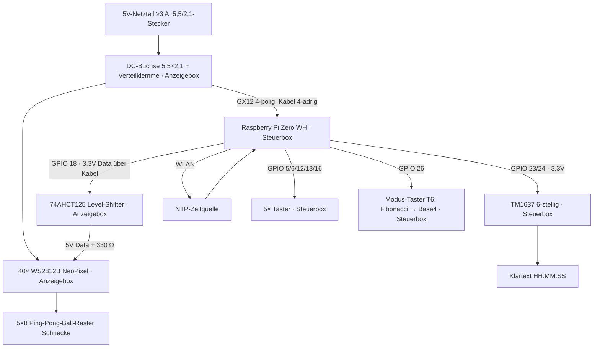
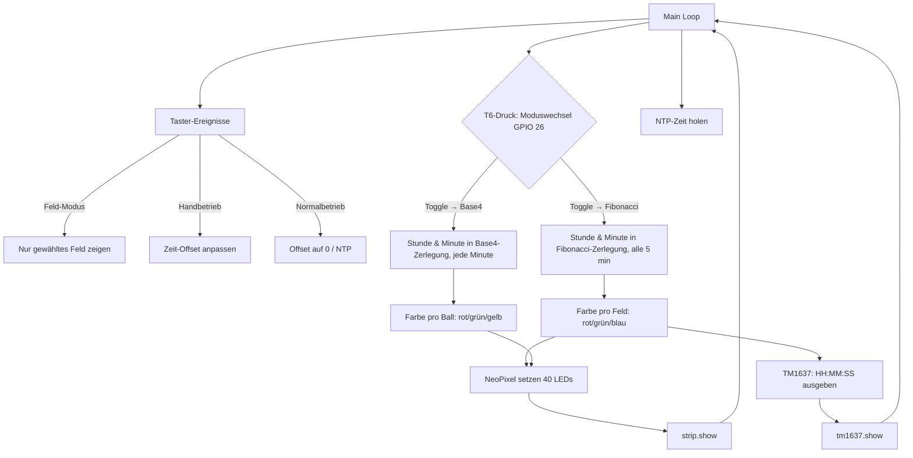

# 🏓 Fibonacci Ping-Pong-Ball-Uhr – Bauanleitung & Entwurf

> Bauanleitung von Paul Simmen, erstellt mit Vibe (GLM-5-2), überarbeitet 20./21.10.2026.
> Eine Fibonacci-LED-Uhr mit 40 Ping-Pong-Bällen im hochkanten 5×8-Raster
> (sich öffnende Fibonacci-Schnecke, Layout der realen Anzeigetafel), gesteuert durch einen Raspberry Pi Zero WH,
> mit zusätzlichem 0,36″ TM1637 6-stelligem LED-Display als Klartext-Anzeige
> und sechs Tastern. Seit der Erweiterung **«Anzeige-Modi» (10.11.2026)**
> wählen T1–T5 die Anzeige-Modi 1–5 direkt, T6 wirkt als **Shift-Taste** für
> die Plätze 6–10 (Toggle, Timeout 10 s); **Langdruck T2–T5** stellt die Zeit
> (+1/+5 min, +1 h, Normalbetrieb). **Platz-Belegung** (Stufe 1–4, seit
> 11.11.2026 vollständig): Platz 1 = Fibonacci, Platz 2 = **Base4**
> (9-Bälle-Wertematrix des Schwesterprojekts, minutengenau), Platz 3 = drei
> Binärzähler h/m/s, Platz 4 = grosse Ziffern, Platz 5 = Tagesfortschritt,
> Platz 6 = Binär-BCD, Platz 7 = EierUhr, Platz 8 = Sekunden-Serpentine,
> Platz 9 = Analog-Uhr, Platz 10 = Pong-Uhr – Details: Kap. 7.11–7.13 und
> docs/Erweiterungen_Anzeigemodi.md. **Langdruck T1** startet die
> Helligkeits-Justage (Kap. 7.13).
>
> **Aufbau in zwei Gehäusen:** **Steuerbox** (Pi, 6 Taster,
> TM1637-Anzeige) und **Anzeigebox** (Lochplatte mit Bällen, NeoPixel,
> Level-Shifter, Kondensatoren, 5V-Anschluss). Versorgungsspannung überall
> **5V**, Datenleitungen **3,3V**.

---

## 1. Funktionsprinzip (Konfidenz: hoch)

### 1.1 Fibonacci-Verlegung im 5×8-Raster (Schnecke)

Die fünf Fibonacci-Felder (Werte 1, 1, 2, 3, 5) kacheln lückenlos in ein
**hochkantes 5×8-Rechteck** – als **sich öffnende Fibonacci-Schnecke**.
Das Layout entspricht der **realen Anzeigetafel** (vermessen; PDF «Fibonacci
Front»). Jedes Feld besteht aus mehreren gleich gefärbten Bällen.

**Positionsangabe:** Eine Position auf der Tafel wird mit **Spalte (A–E) +
Zeile (0–7)** bezeichnet, z. B. «C5» = Spalte C, Zeile 5 – so ist die reale
Tafel beschriftet. **Achtung Namens-Kollision:** Die Spaltenbuchstaben A–E
bezeichnen *Positionen*; die Fibonacci-**Felder** A–E (Werte 5, 3, 2, 1, 1)
liegen teils an anderen Orten – z. B. liegt das Fibonacci-Feld B (Wert 3)
in den Spalten C–E der Tafel.

| Feld | Wert | Bälle | Lage (Spalten × Zeilen)  |
|------|------|-------|--------------------------|
| A    | 5    | 25    | Spalten A–E × Zeilen 0–4 (oben, volle Breite) |
| B    | 3    |  9    | Spalten C–E × Zeilen 5–7 (unten rechts) |
| C    | 2    |  4    | Spalten A–B × Zeilen 6–7 (unten links, unter D/E) |
| D    | 1    |  1    | Spalte A × Zeile 5 (A5, LED 5) |
| E    | 1    |  1    | Spalte B × Zeile 5 (B5, LED 13) |
| **Total** | **12** | **40** | 5×8 = 40 Bälle      |

```
A A A A A
A A A A A
A A A A A
A A A A A
A A A A A
D E B B B     <- D=A5 und E=B5: Zentrum der Schnecke (links)
C C B B B     <- C direkt darunter
C C B B B
```

Die Quadrate öffnen sich vom Zentrum nach aussen: **D → E → C → B → A** –
jedes grössere Quadrat umschliesst die kleineren (klassische Fibonacci-Spirale;
die reale Tafel ist das seitenverkehrte, funktional identische Spiegelbild
des Nerdiy-/Original-Layouts).

### 1.2 Farbcodierung (Fibonacci-Modus)

| Farbe  | Bedeutung                         |
|--------|-----------------------------------|
| rot    | Feld zählt zur Stunde             |
| grün   | Feld zählt zu den Minuten (×5)    |
| blau   | Feld zählt zu Stunde UND Minute   |
| aus    | Feld zählt nicht                  |

*(Im Base4-Modus gilt eine eigene Farbkodierung mit gelb – siehe 1.6.)*

### 1.3 Ablesen

- **Stunde** = Summe(rote Felder) + Summe(blaue Felder)
- **Minute** = (Summe(grüne Felder) + Summe(blaue Felder)) × 5

Anzeige bewusst nur **5-Minuten-genau** (wie im Original).

### 1.4 Beispiel 08:10

| Wert | Stunde | Minute |
|------|--------|--------|
| 5    | ja     | –      |
| 3    | ja     | –      |
| 2    | –      | ja     |
| 1    | –      | –      |
| 1    | –      | –      |

→ Stunde = 5+3 = 8, Minute = 2×5 = 10 → **08:10**

Feld 5 (25 Bälle) und Feld 3 (9 Bälle) leuchten **rot**,
Feld 2 (4 Bälle) leuchtet **grün**, die beiden Einer bleiben **aus**.

### 1.5 Zufallszerlegung (setBits)

Für jede Zahl 1–12 gibt es mehrere gültige Fibonacci-Summen. Die Software
wählt per `random()` eine davon → die Uhr sieht bei jedem 5-Minuten-Wechsel
anders aus (keine Mehrdeutigkeit-Auflösung wie bei Base4 nötig; **Konfidenz: hoch**,
übernommen aus der Original-Arduino-Firmware von Philippe Chretien).

### 1.6 Zweiter Anzeige-Modus: Base4 (ab 21.10.2026 von Beginn integriert)

> **Update (10.11.2026, Erweiterung «Anzeige-Modi»):** Der Wechsel
> Fibonacci ↔ Base4 läuft jetzt über **T2** (Base4 = Anzeige-Modus 2);
> T6 ist seit Stufe 1 die **Shift-Taste** für die Plätze 6–10. Die
> Wertematrix-Beschreibung unten bleibt gültig – Details: Kap. 7.11 und
> docs/Erweiterungen_Anzeigemodi.md.

Der Base4-Modus wird über den **Taster T2** (Anzeige-Modus 2) gewählt; bis
zur Erweiterung schaltete der **Modus-Taster T6** an der Steuerbox (GPIO 26)
live zwischen den beiden Anzeige-Modi um (**jeder Druck wechselt**,
Software-Toggle, entprellt). Nach dem Einschalten startet
die Uhr immer im Fibonacci-Modus.

| Modus | Anzeige | Auflösung |
|---|---|---|
| **Fibonacci** (Start nach Boot) | 5 Felder A–E (Schnecke), rot/grün/blau | 5 Minuten |
| **Base4** | 9-Bälle-Matrix (3×3), rot/grün/gelb | **1 Minute** |

*(Ein Druck auf T6 wechselt jeweils in die andere Zeile.)*

Im Base4-Modus übernehmen **9 der 40 Bälle** die Wertematrix der 9-Bälle-
Ping-Pong-Uhr (Schwesterprojekt) – Zeilen 0–2, Spalten B–D (Positionsindex
1–3), vollständig innerhalb des Fibonacci-Felds A. Die übrigen 31 Bälle bleiben aus.

```
 .  48  12   3 .
 .  32   8   2 .
 .  16   4   1 .
```

| Farbe  | Bedeutung (Base4)                |
|--------|----------------------------------|
| rot    | Ball zählt zur Stunde            |
| grün   | Ball zählt zur Minute            |
| gelb   | Ball zählt zu Stunde UND Minute   |
| aus    | Ball zählt nicht                  |

- **Stunde** = Summe(rote + gelbe Bälle), **Minute** = Summe(grüne + gelbe Bälle)
- Wertemengen (vollständig, seit 14.10.2026 im Schwesterprojekt verifiziert):
  Stunden {16, 12, 8, 4, 3, 2, 1}, Minuten {48, 32, 16, 8, 4, 3, 2, 1} –
  alle 24 Stunden und 60 Minuten lückenlos darstellbar
- **Wichtig:** Im Base4-Modus gilt die Fibonacci-Feldbedeutung der Bälle
  nicht – die 9 Werte ergeben sich aus der obigen Matrix (Wertekarte ins
  Gehäuse legen, wie bei der 9-Bälle-Uhr)

---

## 2. Systemübersicht



| Komponente                     | Box        | Funktion                              |
|-------------------------------|------------|---------------------------------------|
| Pi Zero WH                    | Steuerbox  | Steuerung, NTP, Farb- und Zeitlogik   |
| 5× Bedien-Taster T1–T5        | Steuerbox  | Feld-Modus, Handbetrieb, Normalbetrieb |
| Modus-Taster T6 (GPIO 26)     | Steuerbox  | Moduswechsel Fibonacci ↔ Base4 pro Druck |
| TM1637 6-stellig              | Steuerbox  | Klartext HH:MM:SS (VCC 5V, Daten 3,3V) |
| Level-Shifter 74AHCT125       | Anzeigebox | hebt Data-Leitung 3,3V → 5V vor LED 0 |
| 40× WS2812B NeoPixel          | Anzeigebox | Anzeige im 5×8-Ball-Raster (Schnecke)  |
| 1000 µF Elko (+ nF je Modul)  | Anzeigebox | Stabilisierung der LED-Versorgung     |
| 5V-Einspeisung: DC-Buchse 5,5×2,1 (Anzeigebox) | Anzeigebox | gemeinsame 5V-Einspeisung beider Boxen |
| Verbindungskabel 4-adrig + GX12 4-polig | dazwischen | 5V, GND, Data (3,3V), Reserve |

---

## 3. Hardware-Liste

| # | Teil                          | Zweck                          | Richtpreis CHF | Konf. |
|---|-------------------------------|--------------------------------|----------------|-------|
| 1 | Raspberry Pi Zero WH          | Steuerung + WLAN/NTP           | 25.–           | hoch  |
| 2 | MicroSD 8–16 GB               | OS (Raspberry Pi OS Trixie Lite, 32-bit)             | 8.–            | hoch  |
| 3 | 40× WS2812B NeoPixel          | 1 LED pro Ball                 | 15.–           | hoch  |
| 4 | TM1637 0,36″ 6-stellig        | Klartext HH:MM:SS              | 5.–            | hoch  |
| 5 | 5V-Netzteil ≥3 A              | gemeinsame Versorgung beider Boxen (Einspeisung in Anzeigebox) | 20.– | hoch |
| 6 | Level-Shifter 74AHCT125       | 3,3V→5V Datenpegel (in Anzeigebox verbaut) | 3.–      | hoch  |
| 7 | Widerstand 330–470 Ω          | Schutz am LED-Data-In          | <1.–           | hoch  |
| 8 | Elko 1000 µF / 6,3V           | Stabilisierung an der 5V-Einspeisung (Anzeigebox) | 1.– | hoch |
| 9 | 40× Ping-Pong-Bälle           | Diffusor / Anzeige             | 15.–           | hoch  |
| 10| Lochplatte / Brett 5×8        | Ball-Halterung (200×320 mm hochkant) | Bastelkiste | hoch |
| 11| 5× Taster (Öffner, gg. GND)   | Feld-Modus, Handbetrieb, Normalbetrieb | 2.–      | hoch  |
| 12| Jumper-Wires                  | Verdrahtung TM1637 + Taster (Steuerbox) | 2.–   | hoch  |
| 13| Verbindungskabel 4-adrig ≥0,5 mm² | Anzeigebox↔Steuerbox: 5V, GND, Data, Reserve | 5.– | hoch |
| 14| 1 Paar Avionik-Kupplungen GX12, 4-polig (Stecker + Dose) | Verbindungskabel trennbar steckbar | 8.– | hoch |
| 15| DC-Steckerbuchse 5,5×2,1 mm (Einbau, Gewinde) | 5V-Netzteil-Zuleitung in der Anzeigebox | 3.– | hoch |
| 16| 2× Gehäuse                    | Steuerbox + Anzeigebox         | Bastelkiste   | hoch  |
| 17| 1× Taster (Öffner, gg. GND – wie T1–T5) | Modus-Taster T6: Moduswechsel Fibonacci ↔ Base4 (GPIO 26), aus Lagerbestand | 0.– | hoch |

**Geschätzte Gesamtkosten:** ~118 CHF

---

## 4. Verdrahtung

### 4.1 Stromversorgung (5V) & Gehäuseaufteilung

**Prinzip:** Ein gemeinsames 5V-Netzteil versorgt beide Gehäuse. Alle
Datenleitungen laufen mit **3,3V** (Pi-Pegel); erst der 74AHCT125 in der
Anzeigebox hebt die NeoPixel-Datenleitung auf 5V.

```
                          ┌────────── Steuerbox ──────────────────┐
                          │  Pi Zero WH  ·  5× Taster  ·  TM1637  │
                          │  (Pi & TM1637 versorgt mit 5V)        │
                          └───┬───────────────▲────────────────────┘
              5V + GND       │               │  Data 3,3V (GPIO 18)
              (Verbindungskabel 4-adrig)     │
                          ┌───▼──────────────┴───── Anzeigebox ─────┐
 Netzteil 5V/≥3A ───────► │ DC-Buchse 5,5×2,1 ─┬─ 1000 µF Elko (nah dran) │
                          │                     ├─ 40× NeoPixel VCC (5V)   │
                          │                     └─ 74AHCT125 VCC (Pin 14)  │
                          │ 74AHCT125: 1A (Pin 2) ◄── Data 3,3V    │
                          │             1Y (Pin 3) ─[330–470 Ω]─► DIN LED 0
                          │             OE (Pin 1) → GND           │
                          └────────────────────────────────────────┘
```

**Wichtig (Konfidenz: hoch):**
- **Einspeisung in der Anzeigebox:** Das Netzteil wird an der eingebauten
  **DC-Steckerbuchse 5,5×2,1 mm** angeschlossen (Innenpol = **+5V**, Aussenring
  = GND; Netzteil mit Pluspol innen wählen). Dahinter verteilt eine kleine
  Klemme die 5V an NeoPixel-Kette (bis 2,4 A bei Vollelweiss), 1000 µF-Elko
  und Level-Shifter. Über das Verbindungskabel werden zusätzlich die
  Steuerbox-Komponenten versorgt.
- **Verbindungskabel (4-adrig, ≥0,5 mm²):** 5V, GND, Data (3,3V), Reserve –
  getrennt steckbar über ein **Avionik-Kupplungspaar GX12, 4-polig**
  (Stecker an der einen, Dose an der anderen Box; Panelmontage mit
  ⌀-12-mm-Bohrung, Kontermutter und Kabelverschraubung als Zugentlastung).
  Belegung beidseitig identisch: **Pin 1 = 5V, Pin 2 = GND, Pin 3 = Data,
  Pin 4 = Reserve**; das Metallgehäuse des GX12 wird nicht als Leiter
  benutzt (GND läuft über Pin 2). Das Kabel trägt nur den Strom von
  Pi + TM1637 (~0,5 A) – der NeoPixel-Strom bleibt in der Anzeigebox.
  GX12 4-polig ist dafür strommässig weit überdimensioniert (typ. einige A
  pro Pin; Konfidenz: mittel). Die GND-Ader ist zwingend (gemeinsame
  Masse beider Boxen).
- **Kondensatoren:** 1000 µF-Elko direkt an der 5V-Einspeisung der Kette
  (Empfehlung laut WS2812B-Datenblatt). Die China-Einzelmodule haben meist
  zusätzlich je ein 100 nF onboard – siehe `docs/WS2812B_ChinaModul.pdf`.
- **Pi speisen:** 5V-Pin 2/4 direkt von der Steuerbox-Verteilung (Achtung:
  umgeht den Polyfuse) – oder sauberer über ein am 5V-Kabel angeschlossenes
  Micro-USB-Kabel (Schutz des Pi bleibt wirksam).
- **74AHCT125 (in der Anzeigebox):** VCC (Pin 14) = 5V, GND (Pin 7) = Masse,
  OE (Pin 1) → GND (Ausgang dauerhaft aktiv), 1A (Pin 2) ← Data,
  1Y (Pin 3) → [330–470 Ω] → DIN von LED 0. Unbenutzte Gatter: A-Eingänge
  (Pins 5/9/12) und OE (Pins 4/10/13) auf GND legen.
- **Datenblätter** (im Repo unter `docs/`): `WS2812B_ChinaModul.pdf`,
  `TM1637_7SegmentChinaModul.pdf`, `sn54ahct125.pdf`.

### 4.2 NeoPixel (40 LEDs, in der Anzeigebox)

```
Steuerbox                  Anzeigebox
─────────────              ──────────────────────────────────────────────
GPIO 18 (PWM0) ──Kabel──►  74AHCT125 1A (Pin 2, 3,3V-Pegel)
                            74AHCT125 1Y (Pin 3) ──[330–470 Ω]──► DIN (LED 0 = A0)
                            Kette spaltenweise: A0 → A7 → B0 → B7 → C0 → C7 → D0 → D7 → E0 → E7 (= LED 39)
5V-Verteiler (DC-Buchse) ──┬────────────►  74AHCT125 VCC (Pin 14, 5V)
            ├────────────►  VCC aller NeoPixel (Einspeisung an Spalte A)
GND ────────┴────────────►  GND (74AHCT125 Pin 7 + alle LEDs)
                            + 1000 µF Elko über VCC/GND an der Einspeisung
```

**Wichtig (Konfidenz: hoch):**
- GPIO 18 = PWM0, der klassische Pin für `rpi_ws281x` / Adafruit NeoPixel.
- Die 3,3V-Datenleitung läuft durch das Verbindungskabel bis zum Shifter in
  der Anzeigebox; erst ab 1Y liegt 5V-Pegel an der Kette (Empfehlung laut
  WS2812B-Datenblatt, da VIH der LEDs bei 5V-Versorgung ca. 3,5 V beträgt).
- Bei 40 LEDs ab einer Einspeisung: Spannungsabfall am Ende möglich.
  Falls das ferne Ende farblich „abdriftet" → zweite 5V-Einspeisung am Ende
  (direkt von der 5V-Verteilklemme der Anzeigebox).
- Strom: 40 × 60 mA = 2,4 A (Volleiweiß) → 3A-Netzteil mit Reserve.
- **Stromführung wie Datenkette:** Auf der realen Tafel laufen 5V und GND auf
  derselben spaltenweisen Route mit (A0–A7 → B0–B7 → C0–C7 → D0–D7 → E0–E7).

### 4.3 TM1637 6-stelliges Display (in der Steuerbox)

```
Pi Zero WH               TM1637 Modul (Steuerbox)
─────────────            ────────────
GPIO 23  ──────────────>  CLK   (Daten 3,3V)
GPIO 24  ──────────────>  DIO   (Daten 3,3V)
5V       ──────────────>  VCC   (aus der 5V-Verteilung der Steuerbox)
GND      ──────────────>  GND
```

**Hinweis (Konfidenz: mittel):**
- Versorgung 5V, Daten 3,3V: Laut TM1637-Datenblatt liegt VIH bei ca.
  0,7 × VDD ≈ 3,5 V – der 3,3V-Pegel des Pi ist damit grenzwertig, funktioniert
  mit den China-Modulen aber praktisch immer (`docs/TM1637_7SegmentChinaModul.pdf`).
  Falls die Anzeige unzuverlässig ist: Modul-Pull-ups entfernen oder das Modul
  mit 3,3V betreiben (Anzeige dann geringfügig dunkler).
- Die 6-stellige Variante ist seltener als die 4-stellige; darauf achten,
  dass das Modul tatsächlich 6 Ziffern hat (Typ: „TM1637 6 digit 0.36″").

### 4.4 Taster T1–T6 (in der Steuerbox)

```
Pi Zero WH                    Taster T1–T6
─────────────                 ──────────────────────────────────
GPIO 5   ─────────────────>  T1  (Modus 1 Fibonacci; **lang**: Helligkeits-Justage; Shift: Platz 6 Binär-BCD)
GPIO 6   ─────────────────>  T2  (Modus 2 Base4; **lang**: +1 Minute; Shift: Platz 7 EierUhr)
GPIO 12  ─────────────────>  T3  (Modus 3 Binärzähler; **lang**: +5 Minuten; Shift: Platz 8 Sekunden-Serpentine)
GPIO 13  ─────────────────>  T4  (Modus 4 grosse Ziffern; **lang**: +1 Stunde; Shift: Platz 9 Analog-Uhr)
GPIO 16  ─────────────────>  T5  (Modus 5 Tagesfortschritt; **lang**: Normalbetrieb; Shift: Platz 10 Pong-Uhr)
GPIO 26  ─────────────────>  T6 Shift-Taster (Plätze 6–10; Toggle, Timeout 10 s)
GND      ─────────────────>  gemeinsame Masse aller 6 Taster
```

**Hinweis (Konfidenz: hoch):**
- Öffner-Taster: eine Seite an den GPIO, die andere an GND.
- Die internen Pull-Ups des Pi aktiviert `gpiozero` automatisch
  (`Button(..., pull_up=True)` ist Standard) – keine externen Widerstände nötig.
- Entprellung regelt `gpiozero` in Software (`bounce_time`).
- **Shift-Taster T6 (statt Kippschalter, 07.11.2026; Shift-Funktion seit
  10.11.2026):** gleicher Taster-Typ wie T1–T5 (Öffner, schliesst bei
  Druck), eine Seite an GPIO 26 (Pin 37), die andere an GND – elektrisch
  identisch mit der Kippschalter-Planung. Die Software toggelt pro Druck
  (`when_pressed`, entprellt über `bounce_time`) den Shift-Modus, der nach
  SHIFT_TIMEOUT_SEC (10 s) automatisch endet; Shift + T1–T5 wählen die
  Plätze 6–10 (seit Stufe 4, 11.11.2026, sind alle zehn Plätze belegt –
  reservierte Plätze gibt es keine mehr). **Langdruck T1** startet die
  Helligkeits-Justage (Kap. 7.13 und docs/Helligkeit.md). Nach dem Boot
  startet die Uhr im Fibonacci-Modus (Modus 1, Shift aus).

### 4.5 Gesamt-Pin-Übersicht

| Pin          | Funktion           | Ziel                                          |
|--------------|--------------------|-----------------------------------------------|
| GPIO 18      | PWM0 / NeoPixel    | Kabel → 74AHCT125 1A → 1Y → [330 Ω] → DIN LED 0 |
| GPIO 23      | CLK                | TM1637 (Steuerbox, Daten 3,3V)                 |
| GPIO 24      | DIO                | TM1637 (Steuerbox, Daten 3,3V)                 |
| GPIO 5       | Taster 1           | Feld-Modus (Steuerbox)                        |
| GPIO 6       | Taster 2           | +1 Minute (Steuerbox)                         |
| GPIO 12      | Taster 3           | +5 Minuten (Steuerbox)                        |
| GPIO 13      | Taster 4           | +1 Stunde (Steuerbox)                         |
| GPIO 16      | Taster 5           | Normalbetrieb (Steuerbox)                     |
| GPIO 26      | Taster 6 (T6)      | Moduswechsel Fibonacci ↔ Base4 pro Druck (Steuerbox) |
| 5V (Pin 2/4) | Strom              | Pi + TM1637 (aus Verbindungskabel)            |
| GND          | Masse              | Alle – gemeinsame Masse beider Boxen          |

Strompfad: Netzteil → DC-Buchse 5,5×2,1 → Verteilklemme (Anzeigebox) → NeoPixel + Shifter direkt,
und über das 4-adrige Verbindungskabel → Steuerbox (Pi 5V-Pin, TM1637 VCC).

---

## 5. LED-Mapping (40 LEDs → 5 Felder)

### 5.1 Verdrahtungsreihenfolge (wie die reale Anzeigetafel)

Die LED-Kette läuft **spaltenweise** – Daten- **und** Stromleitung (5V/GND)
auf derselben Route: **IN an A0** (oben links) → **A0–A7** (Spalte A von
oben nach unten) → **B0–B7** → **C0–C7** → **D0–D7** → **E0–E7** (endet
unten rechts). Damit ist die Formel einfach:

```
LED-Index = Spalte × 8 + Zeile     (Spalte A–E = 0–4, Zeile 0–7)
```

> **⚠️ Fallstrick 33 (10.11.2026, am Gerät gemessen):** Die reale Tafel hängt
> spaltenweise **gespiegelt** an der Kette: Die Datenkette beginnt REAL bei
> **Spalte E** (rechts) und läuft E→D→C→B→A – Kettensegment LED 0–7 =
> physische Spalte E usw. Die Formel oben bleibt als **logische** Konvention
> vollständig gültig (Spalte A = links); die Zuordnung zur physischen Kette
> übernimmt `display.py` zentral über die `_PHYS_LED`-Tabelle (physische LED
> = (4 − Spalte) × 8 + Zeile). Sichtbar geworden am Modus 4 (Ziffern
> spiegelverkehrt); die Fibonacci-Anzeige las sich trotzdem immer richtig,
> weil ihre Felder beim Spiegeln die Werte mitnehmen. Details: Kap. 9,
> Fallstrick 33.

Positionsangaben wie «A5» meinen: **Spalte A, Zeile 5** (Beschriftung der
realen Tafel, siehe PDF «Fibonacci Front»).

Das Raster steht **hochkant**: 5 Spalten (Breite) × 8 Zeilen (Höhe).

### 5.2 Mapping-Tabelle

```python
# Feld-Definition: (Wert, [Liste der LED-Indizes])
# Annahme: spaltenweise Kette (IN an A0), LED 0 = Spalte A, Zeile 0 (oben links)

def led_index(spalte, zeile):
    """Spaltenweise Kette: Spalte für Spalte, oben nach unten."""
    return spalte * 8 + zeile

FELDER = {
    5: [led_index(s, z) for s in range(5) for z in range(5)],        # 25 LEDs
    3: [led_index(s, z) for s in range(2, 5) for z in range(5, 8)],  #  9 LEDs
    2: [led_index(s, z) for s in range(0, 2) for z in range(6, 8)],  #  4 LEDs
    1: [led_index(0, 5)],                                            #  1 LED (Feld D = A5)
    1: [led_index(1, 5)],                                            #  1 LED (Feld E = B5)
}
# ACHTUNG: Python-Dictionary kann keine doppelten Keys!
# Besser als Liste von Tupeln:
```

```python
# Korrekt: Liste von (Wert, [LED-Indizes])
# LED-Index = Spalte × 8 + Zeile (spaltenweise Kette, IN an A0)
FELDER = [
    (5, [s * 8 + z for s in range(5) for z in range(5)]),         # Feld A: 25 LEDs (Spalten A–E, Zeilen 0–4)
    (3, [s * 8 + z for s in range(2, 5) for z in range(5, 8)]),   # Feld B:  9 LEDs (Spalten C–E, Zeilen 5–7)
    (2, [s * 8 + z for s in range(0, 2) for z in range(6, 8)]),   # Feld C:  4 LEDs (Spalten A–B, Zeilen 6–7)
    (1, [0 * 8 + 5]),                                             # Feld D:  1 LED (A5 = LED 5)
    (1, [1 * 8 + 5]),                                             # Feld E:  1 LED (B5 = LED 13)
]
NUM_LEDS = 40
```

Feld → LED-Indizes im Überblick (spaltenweise Kette, LED = Spalte×8+Zeile):

| Feld | Wert | LED-Indizes                          |
|------|------|--------------------------------------|
| A    | 5    | 0–4, 8–12, 16–20, 24–28, 32–36       |
| B    | 3    | 21–23, 29–31, 37–39                  |
| C    | 2    | 6, 7, 14, 15                         |
| D    | 1    | 5 (Position A5)                      |
| E    | 1    | 13 (Position B5)                     |

### 5.3 Verifikation

```python
assert sum(len(feld[1]) for feld in FELDER) == 40  # alle LEDs erfasst
assert sum(feld[0] for feld in FELDER) == 12       # 5+3+2+1+1 = 12
```

### 5.4 Base4-Matrix im 5×8-Raster

Der 3×3-Block des Base4-Modus sitzt bei **Zeilen 0–2, Spalten B–D**
(Positionsindex 1–3) – vollständig innerhalb des Fibonacci-Felds A, mittig
oben. Vorteile: keine Trennstege im Block, das dunkle Umfeld rahmt die
Matrix sauber.

| Zeile \ Spalte | B (1)          | C (2)          | D (3)          |
|----------------|----------------|----------------|----------------|
| Zeile 0        | LED 8 · **48** | LED 16 · **12** | LED 24 · **3** |
| Zeile 1        | LED 9 · **32** | LED 17 · **8**  | LED 25 · **2** |
| Zeile 2        | LED 10 · **16** | LED 18 · **4** | LED 26 · **1** |

- LED-Indizes nach derselben Formel: `Spalte × 8 + Zeile`
- Werte identisch zur 9-Bälle-Ping-Pong-Uhr (Schwesterprojekt)
- Der Block überlappt kein Fibonacci-Feld mehrfach bewusst: alle 9 Bälle
  gehören im Fibonacci-Modus zu Feld A – die beiden Modi stören sich nicht

---

## 6. Software-Architektur



### 6.1 Bibliotheken

| Bibliothek     | Zweck                        | Installation                     |
|----------------|------------------------------|----------------------------------|
| `rpi_ws281x`   | NeoPixel-Ansteuerung (PWM)   | `pip install rpi_ws281x` **im venv** |
| `tm1637`      | TM1637-Display-Ansteuerung   | `pip install raspberrypi-tm1637` **im venv** |
| `gpiozero`    | Taster (Pull-Up, Entprellung) | vorinstalliert / `sudo apt install python3-gpiozero` |
| `ntplib`      | NTP-Zeitabfrage              | `pip install ntplib` **im venv** |
| `datetime`    | Zeit-Verarbeitung            | Python Standardbibliothek       |
| `time`        | sleep, Zeit-Funktionen       | Python Standardbibliothek       |
| `random`      | Zufallsauswahl setBits       | Python Standardbibliothek       |

**Hinweis (Trixie):** `pip` installiert seit Bookworm/Trixie nicht mehr ins
System-Python (PEP 668, «externally-managed-environment»). Die pip-Pakete
gehören in eine virtuelle Umgebung – siehe Kapitel 8. Mit
`--system-site-packages` bleibt gpiozero aus dem System sichtbar.

---

## 7. Code-Entwürfe

> **Stand (10.11.2026, Erweiterung «Anzeige-Modi», Stufe 1 + 2):** Die
> Listings 7.1–7.9 sind teils überholt – massgeblich ist der Code im Repo
> (`git pull`). Erneuert: `buttons.py` (Moduswahl/Shift/Langdruck statt
> Feld-Durchschaltung/Handbetrieb), `config.py` (neue Konstanten),
> `display.py` (show_frame + Fallstrick-33-Spiegelung), `main.py`
> ((Modus, Takt)-Loop), `tm1637_display.py` (show_text); neu: `modes.py` +
> `font5x7.py`. Übersicht: Kap. 7.11; Details: docs/Erweiterungen_Anzeigemodi.md.

### 7.1 Konfiguration (`config.py`)

```python
"""Konfiguration der Fibonacci Ping-Pong-Ball-Uhr (5×8 Schnecken-Raster)."""

# --- NeoPixel ---
LED_PIN        = 18          # GPIO 18 (PWM0)
LED_COUNT      = 40          # 5×8 Bälle
LED_FREQ_HZ    = 800000      # WS2812-Standard
LED_DMA        = 10          # DMA-Kanal
LED_BRIGHTNESS = 102         # int 0-255 (rpi_ws281x: uint8_t, KEIN Float!); 102 entspricht ca. 40 % Helligkeit
LED_INVERT     = False
LED_CHANNEL    = 0
LED_STRIP_TYPE = 0x00081000  # ws.WS2811_STRIP_GRB (WS2812-Standard, GRB) - NICHT der Arduino-Wert!
SOFTSTART_BRIGHTNESS = 20    # Soft-Start: Start-Helligkeit (Schutz vor Last-Spitzen, Fallstrick 29)
SOFTSTART_STEP = 2           # Soft-Start: +2 pro Sekunde bis LED_BRIGHTNESS

# --- TM1637 ---
TM1637_CLK     = 23          # GPIO 23
TM1637_DIO     = 24          # GPIO 24
TM1637_BRIGHTNESS = 4        # 0–7

# --- Taster (gpiozero, gegen GND, interner Pull-Up) ---
BTN_FIELD_PIN = 5            # T1: Felder A–E durchschalten
BTN_MIN_PIN   = 6            # T2: Handbetrieb +1 Minute
BTN_MIN5_PIN  = 12           # T3: Handbetrieb +5 Minuten
BTN_HOUR_PIN  = 13           # T4: Handbetrieb +1 Stunde
BTN_NORM_PIN  = 16           # T5: Normalbetrieb (Offset zurücksetzen)
BTN_BOUNCE_SEC = 0.05        # Prellen abfangen

# --- Modus-Taster (T6: Fibonacci <-> Base4, Toggle pro Druck) ---
BTN_MODE_PIN = 26          # GPIO 26 (Pin 37), gegen GND; jeder Druck = umschalten

# --- Farben (R, G, B) ---
COLOR_OFF    = (0,   0,   0)
COLOR_HOURS  = (255, 0,   0)   # rot
COLOR_MIN    = (0,   255, 0)   # grün
COLOR_BOTH   = (0,   0,   255) # blau (Fibonacci: Stunde + Minute)
COLOR_FIELD  = (255, 255, 255) # weiss (Feld-Durchschaltung)
COLOR_BASE4_BOTH = (255, 255, 0) # gelb (Base4: Stunde + Minute)

# --- NTP ---
NTP_SERVER   = "ch.pool.ntp.org"
TIMEZONE     = "Europe/Zurich"

# --- Update ---
UPDATE_INTERVAL_SEC = 1       # Haupt-Loop 1 s: TM1637 zeigt Sekunden (Raster nur bei Änderung neu)
NTP_SYNC_INTERVAL_MIN = 30    # alle 30 min NTP neu synchronisieren
```

### 7.2 LED-Mapping (`mapping.py`)

```python
"""Mapping: 40 physische LEDs → 5 logische Fibonacci-Felder (Schnecke)."""

# Spaltenweise Kette (wie die reale Tafel): LED-Index = Spalte × 8 + Zeile
# IN an A0 (oben links): A0–A7 → B0–B7 → C0–C7 → D0–D7 → E0–E7
# Raster hochkant: 5 Spalten (A–E) × 8 Zeilen (0–7)
# Schnecke: D/E (Zeile 5, Spalten A/B) -> C (darunter) -> B (rechts) -> A (oben)

FELDER = [
    # (Wert, [LED-Indizes])
    (5, [s * 8 + z for s in range(5) for z in range(5)]),          # A: 25 LEDs (Spalten A–E, Zeilen 0–4)
    (3, [s * 8 + z for s in range(2, 5) for z in range(5, 8)]),    # B:  9 LEDs (Spalten C–E, Zeilen 5–7)
    (2, [s * 8 + z for s in range(0, 2) for z in range(6, 8)]),   # C:  4 LEDs (Spalten A–B, Zeilen 6–7)
    (1, [0 * 8 + 5]),                                              # D:  1 LED (A5 = LED 5)
    (1, [1 * 8 + 5]),                                              # E:  1 LED (B5 = LED 13)
]

# Verifikation beim Import
assert sum(len(f[1]) for f in FELDER) == 40, "LED-Anzahl stimmt nicht!"
assert sum(f[0] for f in FELDER) == 12, "Fibonacci-Summe stimmt nicht!"

# Base4-Matrix (2. Anzeige-Modus): 3x3-Block in Zeilen 0-2, Spalten B-D
# (Positionsindex 1-3, innerhalb von Feld A). Werte identisch zur
# 9-Baelle-Ping-Pong-Uhr. LED-Index = Spalte*8 + Zeile
BASE4_MATRIX = [
    # (Wert, LED-Index)
    (48, 1 * 8 + 0), (12, 2 * 8 + 0), ( 3, 3 * 8 + 0),
    (32, 1 * 8 + 1), ( 8, 2 * 8 + 1), ( 2, 3 * 8 + 1),
    (16, 1 * 8 + 2), ( 4, 2 * 8 + 2), ( 1, 3 * 8 + 2),
]
assert len(BASE4_MATRIX) == 9, "Base4-Matrix muss 9 Baelle haben!"
assert [w for w, _ in BASE4_MATRIX] == [48, 12, 3, 32, 8, 2, 16, 4, 1], \
    "Base4-Werte stimmen nicht mit der 9-Baelle-Uhr ueberein!"
```

### 7.3 Taster-Steuerung (`buttons.py`)

```python
"""Taster-Steuerung: Feld-Modus, Handbetrieb (Offset), Normalbetrieb,
Moduswechsel Fibonacci <-> Base4 (Modus-Taster T6, Toggle pro Druck)."""
from gpiozero import Button
from config import (BTN_FIELD_PIN, BTN_MIN_PIN, BTN_MIN5_PIN,
                    BTN_HOUR_PIN, BTN_NORM_PIN, BTN_MODE_PIN, BTN_BOUNCE_SEC)

MODE_NORMAL = "normal"   # NTP-Zeit, Fibonacci-Anzeige
MODE_MANUAL = "manual"   # Zeitversatz (Offset), Uhr läuft weiter
MODE_FIELD  = "field"    # Feld-Durchschaltung A-E

class ButtonController:
    """
    Fragt die Bedien-Taster T1–T5 und den Modus-Taster T6 ab (gpiozero,
    interne Pull-Ups, softwareseitig entprellt).

    Handbetrieb = Offset in Sekunden zur Systemzeit; Taster 5 setzt ihn auf 0.
    on_event(mode, field_idx, offset_sec) wird bei jedem Tasterdruck aufgerufen
    ( gpiozero ruft when_pressed in einem Hintergrund-Thread auf ).

    Der Modus-Taster T6 (GPIO 26, gegen GND) wechselt bei jedem Druck die
    Anzeige zwischen Fibonacci und Base4 (Software-Toggle, entprellt).
    Der Zustand steht in der Software – nach dem Boot startet die Uhr im
    Fibonacci-Modus. Abfrage im Hauptprogramm per is_base4().
    """

    def __init__(self, on_event):
        self._notify = on_event
        self._mode = MODE_NORMAL
        self._field = -1
        self._offset_sec = 0

        taster = {
            "field": Button(BTN_FIELD_PIN, bounce_time=BTN_BOUNCE_SEC),
            "min":   Button(BTN_MIN_PIN,   bounce_time=BTN_BOUNCE_SEC),
            "min5":  Button(BTN_MIN5_PIN,  bounce_time=BTN_BOUNCE_SEC),
            "hour":  Button(BTN_HOUR_PIN,  bounce_time=BTN_BOUNCE_SEC),
            "norm":  Button(BTN_NORM_PIN,  bounce_time=BTN_BOUNCE_SEC),
        }
        taster["field"].when_pressed = self._field_pressed
        taster["min"].when_pressed   = lambda: self._manual_pressed(60)
        taster["min5"].when_pressed  = lambda: self._manual_pressed(300)
        taster["hour"].when_pressed  = lambda: self._manual_pressed(3600)
        taster["norm"].when_pressed  = self._normal_pressed

        # Modus-Taster T6: jeder Druck wechselt Fibonacci <-> Base4;
        # Prellen über bounce_time abfangen (genau 1 Ereignis pro Druck)
        self._base4 = False   # Start nach Boot: Fibonacci-Modus
        self._mode_btn = Button(BTN_MODE_PIN, bounce_time=BTN_BOUNCE_SEC)
        self._mode_btn.when_pressed = self._mode_pressed

    def is_base4(self):
        """True = Base4-Anzeige aktiv (Software-Toggle via T6)."""
        return self._base4

    def _mode_pressed(self):
        """T6: Anzeige-Modus umschalten (Fibonacci <-> Base4)."""
        self._base4 = not self._base4
        self._emit()   # Haupt-Loop rendert im neuen Modus

    def _emit(self):
        self._notify(self._mode, self._field, self._offset_sec)

    def _field_pressed(self):
        """Taster 1: Felder A-E durchschalten (Fibonacci-Funktion)."""
        self._mode = MODE_FIELD
        self._field = (self._field + 1) % 5
        self._emit()

    def _manual_pressed(self, delta):
        """Taster 2/3/4: +1 Minute / +5 Minuten / +1 Stunde."""
        self._mode = MODE_MANUAL
        self._offset_sec += delta
        self._emit()

    def _normal_pressed(self):
        """Taster 5: Normalbetrieb – Offset auf 0."""
        self._mode = MODE_NORMAL
        self._offset_sec = 0
        self._emit()
```

### 7.4 Fibonacci-Zerlegung (`fibonacci.py`)

```python
"""Fibonacci-Zerlegung mit Zufallsauswahl (portiert von Arduino setBits)."""
import random

FIB_VALUES = [1, 1, 2, 3, 5]  # Die fünf Fibonacci-Feldwerte

# Alle gültigen Kombinationen für Werte 1–12
# Jede Kombination ist eine Liste von Feld-Indizes (0–4)
# WICHTIG (08.11.2026, Bugfix Fallstrick 28): Feld-Index = mapping.FELDER-Index
#   0 = A (Wert 5), 1 = B (Wert 3), 2 = C (Wert 2), 3 = D (Wert 1), 4 = E (Wert 1)
# Vorher nummerierte diese Tabelle 0–4 = [1,1,2,3,5] - das passte nicht zu mapping.FELDER.
COMBINATIONS = {
    1:  [[3], [4]],
    2:  [[2], [3, 4]],
    3:  [[1], [3, 2], [4, 2]],
    4:  [[3, 1], [4, 1], [3, 4, 2]],
    5:  [[0], [2, 1], [3, 4, 1]],
    6:  [[3, 0], [4, 0], [3, 2, 1], [4, 2, 1]],
    7:  [[2, 0], [3, 4, 0], [3, 4, 2, 1]],
    8:  [[1, 0], [3, 2, 0], [4, 2, 0]],
    9:  [[3, 1, 0], [4, 1, 0]],
    10: [[2, 1, 0], [3, 4, 1, 0]],
    11: [[3, 2, 1, 0], [4, 2, 1, 0]],
    12: [[3, 4, 2, 1, 0]],
}

def set_bits(value, offset):
    """
    Wählt per Zufall eine gültige Fibonacci-Kombination für value (1–12).
    (offset ist historisch aus dem Arduino-Port und wird nicht benutzt.)
    Gibt die Liste der gesetzten Feld-Indizes zurück (0–4 = A–E).
    """
    value = max(1, min(12, value))
    combo = random.choice(COMBINATIONS[value])
    return combo

def get_field_assignment(hours, minutes):
    """
    Bestimmt für Stunde (1–12) und Minute (0–59) welche Felder
    leuchten und mit welcher Bedeutung.
    Gibt ein Dict zurück: {feld_index: 'hours'|'minutes'|'both'|'off'} — feld_index = mapping.FELDER-Index (0–4 = A–E)
    """
    hours_12 = hours % 12
    if hours_12 == 0:
        hours_12 = 12
    min_units = minutes // 5  # 0–12 (5-Minuten-Schritte)
    if min_units == 0:
        min_units = 12  # 0 Minuten = 12 in Fibonacci-Darstellung

    field_bits = [0] * 5  # 0=off, 1=hours, 2=minutes, 3=both

    hour_fields = set_bits(hours_12, 0x01)
    min_fields  = set_bits(min_units, 0x02)

    for f in hour_fields:
        field_bits[f] |= 0x01
    for f in min_fields:
        field_bits[f] |= 0x02

    assignment = {}
    for i in range(5):
        if field_bits[i] == 0x01:
            assignment[i] = 'hours'
        elif field_bits[i] == 0x02:
            assignment[i] = 'minutes'
        elif field_bits[i] == 0x03:
            assignment[i] = 'both'
        else:
            assignment[i] = 'off'

    return assignment
```

### 7.5 Base4-Zerlegung (`base4.py`)

```python
"""Base4-Zerlegung – portiert aus der 9-Baelle-Ping-Pong-Uhr (Schwesterprojekt).
Wertemengen seit 14.10.2026 vollstaendig (alle 24 h / 60 min darstellbar)."""
from mapping import BASE4_MATRIX

# Werte je Ball (feste Position, siehe mapping.BASE4_MATRIX)
HOUR_VALUES   = [16, 12, 8, 4, 3, 2, 1]        # 48/32 nur fuer Minuten
MINUTE_VALUES = [48, 32, 16, 8, 4, 3, 2, 1]

def _decompose(value, values):
    """Zerlegt value gierig in Summanden aus values (jeder Wert max. 1x)."""
    parts = []
    for v in values:
        if v <= value:
            parts.append(v)
            value -= v
    return parts

def get_ball_states(h, m):
    """
    Liefert {led_index: 'hours'|'minutes'|'both'|'off'} fuer die 9 Matrix-Baelle.
    Im Base4-Modus bedeutet 'both' GELB (Stunde + Minute), nicht blau.
    Aufloesung: 1 Minute (Update jede Minute).
    """
    h = h % 24
    hparts = set(_decompose(h, HOUR_VALUES))
    mparts = set(_decompose(m, MINUTE_VALUES))

    states = {}
    for wert, led in BASE4_MATRIX:
        role = 'off'
        if wert in hparts and wert in mparts:
            role = 'both'          # gelb
        elif wert in hparts:
            role = 'hours'         # rot
        elif wert in mparts:
            role = 'minutes'       # gruen
        states[led] = role
    return states
```

### 7.6 NeoPixel-Ansteuerung (`display.py`)

```python
"""NeoPixel-Ansteuerung für 40 LEDs im 5×8-Schnecken-Raster."""
from rpi_ws281x import PixelStrip, Color
from config import *
from mapping import FELDER

strip = PixelStrip(
    LED_COUNT, LED_PIN, LED_FREQ_HZ, LED_DMA,
    LED_INVERT, LED_BRIGHTNESS, LED_CHANNEL, LED_STRIP_TYPE
)
strip.begin()

# Farb-Tabelle
COLOR_MAP = {
    'off':    Color(0, 0, 0),
    'hours':  Color(255, 0, 0),    # rot  (GRB-Reihenfolge beachten!)
    'minutes': Color(0, 255, 0),    # grün
    'both':   Color(0, 0, 255),    # blau (Fibonacci: Stunde + Minute)
    'both4':  Color(255, 255, 0),  # gelb (Base4: Stunde + Minute)
    'field':  Color(255, 255, 255), # weiss (Feld-Durchschaltung)
}

def show_time(field_assignment):
    """
    Setzt alle 40 LEDs gemäß field_assignment.
    field_assignment: {feld_index: 'hours'|'minutes'|'both'|'off'}
    """
    for feld_idx, (wert, led_liste) in enumerate(FELDER):
        role = field_assignment.get(feld_idx, 'off')
        color = COLOR_MAP[role]
        for led in led_liste:
            strip.setPixelColor(led, color)
    strip.show()

def show_field(field_idx):
    """
    Zeigt genau ein Feld (0–4 = A–E) in weiss, alle anderen aus.
    Für den Feld-Durchschalt-Modus (Taster 1).
    """
    for i in range(LED_COUNT):
        strip.setPixelColor(i, COLOR_MAP['off'])
    wert, led_liste = FELDER[field_idx]
    for led in led_liste:
        strip.setPixelColor(led, COLOR_MAP['field'])
    strip.show()

def show_base4(ball_states):
    """
    Zeigt die Base4-Matrix: 9 Bälle gemäß ball_states
    ({led_index: 'hours'|'minutes'|'both'|'off'}), alle übrigen LEDs aus.
    'both' = gelb (im Base4-Modus), nicht blau!
    """
    role_color = {'hours': 'hours', 'minutes': 'minutes',
                  'both': 'both4', 'off': 'off'}
    for i in range(LED_COUNT):
        strip.setPixelColor(i, COLOR_MAP['off'])
    for led, role in ball_states.items():
        strip.setPixelColor(led, COLOR_MAP[role_color[role]])
    strip.show()

def clear_all():
    """Schaltet alle LEDs aus."""
    for i in range(LED_COUNT):
        strip.setPixelColor(i, Color(0, 0, 0))
    strip.show()
```

### 7.7 TM1637-Ansteuerung (`tm1637_display.py`)

```python
"""TM1637 6-stelliges Display – zeigt HH:MM:SS."""
import tm1637
from config import *

display = tm1637.TM1637(clk=TM1637_CLK, dio=TM1637_DIO)
display.brightness(TM1637_BRIGHTNESS)

# Wichtig (08.11.2026, Library-Quellcode geprueft): raspberrypi-tm1637 ist
# auf 4-stellige Module ausgelegt - show() nimmt Strings (4 Zeichen laut
# Doku), und clear() existiert NICHT. Fuer 6 Stellen: write(segments, 0)
# mit encode_digit()/encode_string() - write() schreibt bis 6 Segmente.

# Fix 10.11.2026 (Fallstrick 31, endgueltig): Das 6-stellige Modul zeigt
# die an write() uebergebene Segmentliste SPIEGELVERKEHRT je Haelfte an:
# Anzeige = [w2, w1, w0, w5, w4, w3]. Gemessen 10.11. mit dem Roh-Befehl
# d.write(d.encode_string('123456'), 0): das Modul zeigte «321654».
# Die Library schreibt die Segmente in Reihenfolge (Quellcode geprueft) -
# die Spiegelung liegt komplett in der Grid-Verdrahtung des China-Moduls.
# Die erste These 09.11. («Ziffernpaare 1/2 vertauscht», Commit a89a5a4)
# beruhte auf fehlgelesenen Beobachtungen und wurde verworfen.
# _modul_segments() kehrt deshalb jede 3-Zeichen-Haelfte der Segmentliste
# um, damit der Text physisch richtig erscheint.

def _modul_segments(segments):
    """Passt die Segmentreihenfolge an das Modul an (Haelften spiegeln)."""
    s = list(segments[:6]) + [0] * (6 - len(segments))
    return [s[2], s[1], s[0], s[5], s[4], s[3]]

def show_clock(hours, minutes, seconds):
    """Zeigt HH:MM:SS auf dem 6-stelligen TM1637 (fuehrende Nullen inkl.)."""
    segs = [
        display.encode_digit(hours   // 10), display.encode_digit(hours   % 10),
        display.encode_digit(minutes // 10), display.encode_digit(minutes % 10),
        display.encode_digit(seconds // 10), display.encode_digit(seconds % 10),
    ]
    display.write(_modul_segments(segs), 0)
    # Doppelpunkte/Dezimalpunkte stecken im MSB je Segment - deren Lage ist
    # modulabhaengig; fuer HH:MM:SS reicht die 6-Ziffern-Anzeige ohne
    # Colon-Steuerung (die Doppelpunkte des Moduls bleiben aus).

def show_text(text):
    """Zeigt kurzen Text (max. 6 Zeichen)."""
    display.write(_modul_segments(display.encode_string(str(text)[:6])), 0)

def show_field_text(field_idx, value):
    """Zeigt im Feld-Durchschalt-Modus z.B. 'A 5' (Buchstabe + Wertigkeit)."""
    letter = "AbCdE"[field_idx]
    display.write(_modul_segments(display.encode_string(f"{letter} {value}"[:6])), 0)

def clear_display():
    display.write([0, 0, 0, 0, 0, 0], 0)

```

### 7.8 Zeit-Verwaltung (`ntp_time.py`)

```python
"""NTP-Zeitsynchronisation und lokale Zeit.

Fix 09.11.2026 (Fallstrick 30): sync_ntp() wertet die NTP-Antwort jetzt
selbst aus. Vorher wurde die Serverzeit abgefragt und verworfen - die Uhr
lief unbemerkt auf der Systemzeit, die nach einem frischen SD-Flash oft
noch nicht synchronisiert ist (bis systemd-timesyncd greift).
"""
import time as time_module
from datetime import datetime, timedelta, timezone
import ntplib
from config import NTP_SERVER, TIMEZONE

try:
    from zoneinfo import ZoneInfo
    _tz = ZoneInfo(TIMEZONE)          # Europe/Zurich inkl. Sommerzeit
except Exception:
    _tz = None                        # Fallback: Systemzeitzone

_ntp_client = ntplib.NTPClient()
_last_sync = None      # time.monotonic() des letzten erfolgreichen Syncs
_ntp_epoch = None      # NTP-Epoch (resp.tx_time) zu diesem Moment

def sync_ntp():
    """Synchronisiert die Uhrzeit ueber NTP. Gibt True bei Erfolg zurueck.

    Speichert die Serverzeit als Referenz-Epoch; get_local_time() rechnet
    ab da mit time.monotonic() weiter. monotonic() kann nicht springen -
    auch dann nicht, wenn systemd-timesyncd die Systemzeit unterdessen
    umstellen sollte.
    """
    global _last_sync, _ntp_epoch
    try:
        resp = _ntp_client.request(NTP_SERVER, version=3, timeout=2)
        _ntp_epoch = resp.tx_time
        _last_sync = time_module.monotonic()
        return True
    except Exception as e:
        print(f"NTP-Fehler: {e}")
        return False

def get_local_time(offset_sec=0):
    """
    Gibt lokale Zeit als (hour, minute, second) zurueck.
    offset_sec: Handbetrieb-Offset in Sekunden (Taster 2-4),
    0 = Normalbetrieb mit NTP-Zeit.

    Nach dem ersten erfolgreichen NTP-Sync laeuft die Uhr ausschliesslich
    auf der NTP-Referenz (unabhaengig von der Systemzeit). Vor dem ersten
    Sync: Fallback auf Systemzeit.
    """
    if _ntp_epoch is not None and _last_sync is not None:
        epoch = _ntp_epoch + (time_module.monotonic() - _last_sync) \
                + offset_sec
        jetzt = datetime.fromtimestamp(epoch, tz=timezone.utc)
        if _tz is not None:
            jetzt = jetzt.astimezone(_tz)
        else:
            jetzt = jetzt.astimezone()   # Systemzeitzone
        return jetzt.hour, jetzt.minute, jetzt.second
    # Fallback vor dem ersten Sync: Systemzeit
    now = datetime.now() + timedelta(seconds=offset_sec)
    return now.hour, now.minute, now.second

def needs_resync(interval_min=30):
    """Prueft, ob eine NTP-Resynchronisation faellig ist."""
    if _last_sync is None:
        return True
    elapsed_min = (time_module.monotonic() - _last_sync) / 60
    return elapsed_min >= interval_min

```

### 7.9 Hauptprogramm (`main.py`)

```python
#!/usr/bin/env python3
"""Fibonacci Ping-Pong-Ball-Uhr – Hauptprogramm
(5×8 Schnecke, 6 Taster, Modus-Taster T6: Fibonacci <-> Base4)."""
import time
import signal
import sys

from config import *
from mapping import FELDER
from fibonacci import get_field_assignment
from base4 import get_ball_states
from buttons import ButtonController, MODE_NORMAL, MODE_MANUAL, MODE_FIELD
from display import strip, show_time, show_field, show_base4, clear_all
from tm1637_display import show_clock, show_field_text, clear_display
from ntp_time import sync_ntp, get_local_time, needs_resync

running = True
state = {"mode": MODE_NORMAL, "field": 0, "offset": 0}

def on_event(mode, field_idx, offset_sec):
    """Callback des ButtonControllers – aktualisiert den Zustand."""
    state["mode"] = mode
    state["field"] = field_idx
    state["offset"] = offset_sec

def signal_handler(sig, frame):
    global running
    running = False
    clear_all()
    clear_display()
    print("Uhr gestoppt.")
    sys.exit(0)

signal.signal(signal.SIGINT, signal_handler)
signal.signal(signal.SIGTERM, signal_handler)

def main():
    print("Fibonacci Ping-Pong-Ball-Uhr startet...")

    # Taster + Modus-Schalter
    buttons = ButtonController(on_event)

    # Erste NTP-Synchronisation
    print("Synchronisiere NTP...")
    if not sync_ntp():
        print("WARNUNG: NTP-Sync fehlgeschlagen – laufe mit Systemzeit.")

    last_display_time = ""
    last_raster = None  # was zuletzt im Raster stand

    # Soft-Start: Helligkeit langsam hochfahren - bei Minuten 0-4 gehen
    # sofort alle 40 LEDs an; mit Rampe kein Last-Schlag beim Start
    # (wichtig, wenn Pi und Tafel am selben Netzteil haengen - Fallstrick 29)
    brightness = SOFTSTART_BRIGHTNESS
    strip.setBrightness(brightness)

    while running:
        # Soft-Start: Helligkeit stufenweise hochfahren
        if brightness < LED_BRIGHTNESS:
            brightness = min(LED_BRIGHTNESS, brightness + SOFTSTART_STEP)
            strip.setBrightness(brightness)
            strip.show()

        # NTP gelegentlich resynchronisieren
        if needs_resync(NTP_SYNC_INTERVAL_MIN):
            sync_ntp()

        # Feld-Modus ist eine Fibonacci-Funktion: bei Base4-Anzeige
        # (T6 umgeschaltet) automatisch verlassen
        if state["mode"] == MODE_FIELD and buttons.is_base4():
            state["mode"] = MODE_NORMAL

        if state["mode"] == MODE_FIELD:
            # --- Feld-Durchschaltung (Taster 1): Feld weiss zeigen ---
            if last_raster != ("field", state["field"]):
                wert, leds = FELDER[state["field"]]
                show_field(state["field"])
                show_field_text(state["field"], wert)
                last_raster = ("field", state["field"])
                print(f"Feldmodus: {'ABCDE'[state['field']]} (Wert {wert})")
        else:
            h, m, s = get_local_time(state["offset"])

            # --- TM1637: jede Sekunde aktualisieren ---
            current_display = f"{h:02d}{m:02d}{s:02d}"
            if current_display != last_display_time:
                show_clock(h, m, s)
                last_display_time = current_display

            if buttons.is_base4():
                # --- Base4-Modus: Update jede Minute ---
                if last_raster != ("base4", (h, m)):
                    show_base4(get_ball_states(h, m))
                    last_raster = ("base4", (h, m))
                    print(f"Base4: {h:02d}:{m:02d}")
            else:
                # --- Fibonacci-Modus: Update alle 5 Minuten ---
                slot = (h, m // 5)
                if last_raster != ("fib", slot):
                    assignment = get_field_assignment(h, m)
                    show_time(assignment)
                    last_raster = ("fib", slot)
                    print(f"Zeit: {h:02d}:{m:02d} – Felder: {assignment}")

        # Kurze Pause
        time.sleep(UPDATE_INTERVAL_SEC)

if __name__ == "__main__":
    main()
```

### 7.10 Autostart (systemd-Service)

> **Status (10.11.2026): eingerichtet und in Betrieb – Reboot-Test bestanden.**
> Die Uhr startet nach dem Einschalten autonom.

Datei: `/etc/systemd/system/fibonacci-clock.service`

```ini
[Unit]
Description=Fibonacci Ping-Pong-Ball-Uhr
After=network-online.target
Wants=network-online.target

[Service]
Type=simple
User=root
ExecStart=/home/paul-rppi/fibonacci-clock/venv/bin/python3 /home/paul-rppi/fibonacci-clock/main.py
Restart=on-failure
RestartSec=10

[Install]
WantedBy=multi-user.target
```

> **Pfad:** `ExecStart` ist auf den Benutzer `paul-rppi` dieses Aufbaus
> gesetzt – bei anderem Benutzernamen beide Pfade anpassen.

Aktivieren:
```bash
sudo systemctl daemon-reload
sudo systemctl enable fibonacci-clock
sudo systemctl start fibonacci-clock
sudo systemctl status fibonacci-clock
```

> **Wieso root?** `rpi_ws281x` braucht Zugriff auf PWM/DMA → root-Rechte.
> Alternative: udev-Regel für nicht-root (fortgeschritten).
>
> **venv-Python:** `ExecStart` zeigt auf die venv-Python aus Kap. 8 – dort
> liegen rpi_ws281x/tm1637/ntplib; gpiozero kommt über
> `--system-site-packages` aus dem System.
>
> **Log beobachten:** `journalctl -u fibonacci-clock -f` (beenden mit q) – dort
> erscheinen die «Zeit: … – Felder: …»-Zeilen des Hauptprogramms.

### 7.11 Erweiterung «Anzeige-Modi» (10.11.2026, Stufe 1 + 2)

Seit 10.11.2026 zeigt die Uhr **zehn Anzeige-Modi**; die Listings 7.1–7.9 sind
in Teilen überholt – massgeblich ist der Code im Repo (git clone / git pull).
Die Erweiterung ändert die Software wie folgt:

| Datei | Status | Änderung |
|---|---|---|
| `modes.py` | **neu** | Modus-Registry für Platz 1–10 (name, available, tick, render); Fibonacci/Base4 als Wrapper auf die bestehenden Funktionen; Platz 3 (drei Binärzähler h/m/s) und Platz 4 (grosse Ziffern) ab Stufe 2; Platz 5–10 reserviert |
| `font5x7.py` | **neu** | Klassischer 5×7-Punktmatrix-Font (Ziffern 0–9, «:»), Spaltenbytes, Bit 0 = oben |
| `buttons.py` | ersetzt | T1–T5 = Moduswahl Platz 1–5, T6 = Shift für Platz 6–10 (Toggle, Timeout SHIFT_TIMEOUT_SEC 10 s), Langdruck T2–T5 = Zeitverstellung (+1/+5 min, +1 h, Normalbetrieb); TM1637-Feedback «M n»/«- n»/«SHIFT»/«1MIN»/«5MIN»/«1STD»/«NORM» |
| `config.py` | ergänzt | SHIFT_TIMEOUT_SEC, TM1637_FEEDBACK_SEC, ZIFFERN_WECHSEL_SEC (2 s); Taster-Kommentare auf Kurz = Moduswahl / Lang = Zeit umgestellt |
| `display.py` | ergänzt | `show_frame()` (generische Schnittstelle: 40 × (R, G, B), Index = logischer LED-Index) + `_PHYS_LED`-Spiegelung (Fallstrick 33) |
| `tm1637_display.py` | ergänzt | `show_text()` zeichensatz-sicher (nur 0–9, a–z, A–Z, Leerzeichen, «-», «*» – KEIN «+») |
| `main.py` | umgestellt | (Modus, tick)-gesteuertes Rendering über modes.get_tick/get_frame + display.show_frame; Log auf max. 1 Zeile/Minute gedrosselt (Modus 3/4 rendern sekündlich) |
| `anzeige_test.py` | ergänzt | Demo-Routine render() schreibt über `display._PHYS_LED` (Fallstrick 33) |

**Betrieb:** Boot = Modus 1 (Fibonacci), Shift aus, Offset 0. Kurzdruck T1–T5
wählt den Modus («M n»), Shift+T1–T5 die Plätze 6–10 (reserviert: «- n»).
Modus 3: Spalte A = Stunden (5 bit, rot), C = Minuten (6 bit, grün), E =
Sekunden (6 bit, gelb), LSB unten, B/D dunkel als Trenner. Modus 4: eine
Ziffer füllt die Tafel (font5x7, Zeilen 0–6), Folge H-Zehner → H-Einer →
M-Zehner → M-Einer alle ZIFFERN_WECHSEL_SEC = 2 s (minutenorientiert, H-Zehner
bei Sekunde 0), Stunden rot / Minuten grün, weisser Sekundenpunkt unten Mitte
(LED 23, an bei gerader Sekunde).

**Verifikation:** Stub-Tests vor jedem Push (Stufe 1: 16 Gruppen; Stufe 2:
16 Gruppen; Fallstrick 33: 22 Checks) – Zusammenfassungen in
docs/Erweiterungen_Anzeigemodi.md, Kap. 10.

**Am Gerät bestätigt (10.11.2026, Paul):** Stufe 1 (Tasten inkl. Shift,
Langdruck, Feedback) und Stufe 2 inkl. Fallstrick-33-Fix – «Jetzt ist die
gesamte Anzeige kohärent»: Modus 4 aufrecht, Modus 3 Stunden-Spalte rot
links, Base4 seitenrichtig, Fibonacci unverändert korrekt.

### 7.12 Erweiterung «Anzeige-Modi» Stufe 3 (11.11.2026)

Seit 11.11.2026 sind die Plätze 5–8 aktiv (Kap. 7.11 beschreibt Stufe 1 + 2):

| Datei | Status | Änderung |
|---|---|---|
| `modes.py` | ergänzt | Vier Frame-Funktionen: Platz 5 Tagesfortschritt (36 min je LED, Kettenreihenfolge, ganze Leiste in Tagesphasen-Farbe DAY_PHASES: Nacht blau, Morgen orange, Mittag gelb, Abend rot), Platz 6 Binär-BCD (Spalte je Dezimalziffer, LSB unten, mit Sekunden-Einer in Spalte E), Platz 7 EierUhr (Sanduhr: Umriss 25 LEDs gedimmt COLOR_GLAS, 6 gelbe Kugeln à 30 s, 3-Minuten-Zyklus an volle Minuten, Falllogik Variante 1), Platz 8 Sekunden-Serpentine erweitert (Runde 1 grün füllend, ab Sekunde 40 gedimmt stehen + Runde 2 orange übermalend) |
| `config.py` | ergänzt | COLOR_GLAS, COLOR_ORANGE, SERPENTINE_DIM_FAKTOR (0.3), DAY_PHASES |
| `test_stufe3.py` | **neu** | Stub-Test der Modi 5–8 gegen unabhängige Referenzlogik: 65 Checks (u. a. Modus 6 über 14 976 Zeitpunkte, Modus 7 über 3600 Fälle, Regression Modi 1–4) |
| `main.py`, `buttons.py`, `display.py` | unverändert | Registry-Schnittstelle aus Stufe 1 greift automatisch; TM1637-Feedback «M 5»–«M 8» |

**Betrieb:** T5 = Tagesfortschritt, Shift+T1 = Binär-BCD, Shift+T2 = EierUhr,
Shift+T3 = Sekunden-Serpentine (Kurzbeschreibungen und LED-Layouts siehe
docs/Erweiterungen_Anzeigemodi.md, Kap. 5).

**Standard-Sequenz «neue Software am Gerät testen» (11.11.2026):**

```bash
sudo systemctl stop fibonacci-clock
cd ~/fibonacci-clock && git pull
sudo venv/bin/python3 main.py
```

Dienst stoppen → Software aktualisieren → Hauptprogramm im Vordergrund
testen (Modi über die Taster, Ende mit Strg+C; zwingend sudo, Fallstrick 32).
Danach den Dienst wieder starten: `sudo systemctl start fibonacci-clock`.

**Am Gerät bestätigt (11.11.2026, Paul: «Die neuen Modi funktionieren!»):**
Alle vier Modi geprüft – T5, Shift+T1, Shift+T2, Shift+T3.

**Umgesetzt mit Stufe 4 (11.11.2026):** Fall-Animation des Sandkorns in
der EierUhr, Platz 9 (Analog-Uhr) und Platz 10 (Pong-Uhr) – Details siehe
Kap. 7.13.

---

### 7.13 Erweiterung «Anzeige-Modi» Stufe 4 + Helligkeits-Justage (11.11.2026)

Stufe 4 vervollständigt die zehn Anzeige-Plätze und ergänzt die manuelle
Helligkeits-Justage. Alle Details und Designentscheide:
docs/Erweiterungen_Anzeigemodi.md, docs/Helligkeit.md.

**Helligkeits-Justage (Phase 1):**

- **Langdruck T1** startet/beendet die Justage (Toggle, Timeout 10 s).
- **T2** dunkler, **T3** heller – Schritte ±5 %, Bereich 5–100 %.
- TM1637 zeigt während der Justage «brNN» (NN = Prozent).
- Gespeichert in `helligkeit.txt` (persistent, Default 40 % = Rohwert 102),
  umgesetzt in `helligkeit.py`; die Boot-Rampe (Fallstrick 29) bleibt
  erhalten. 56 Stub-Checks: `python3 test_helligkeit.py`.
- **Geplant, Phase 2:** Automatik mit BH1750-Lichtsensor (I2C) – Modul
  bestellt (11.11.2026). Log-Kurve: 10 lux→10 %, 300 lux→50 %,
  10 000 lux→100 %, Hysterese ±5 %, Update alle 30 s; manuelle Justage
  schaltet auf MANUELL. Plan: docs/Helligkeit.md.

**Stufe 4 – neue Dateien/Änderungen:**

| Datei | Änderung |
|---|---|
| `modes.py` | Modus 7 EierUhr: **Fall-Animation** – Korn wandert in der Fallssekunde C3→C4, je `EIERUHR_FALL_MS` (150 ms), gelandet nach 300 ms; Zyklusstart (elapsed < 30 s) ohne Animation. Modus 9 **Analog-Uhr**: 12 Positionen (C0=16, D0=24, E1=33, E4=36, E5=37, D7=31, C7=23, B7=15, A5=5, A3=3, A1=1, B0=8), Stunden rot/Minuten grün im 5-min-Raster, beide auf derselben LED = gelb, Referenzpunkte 12/3/6/9 schwach weiss (`COLOR_ANALOG_REF`). Modus 10 **Pong-Uhr**: quer gelesen (Uhr 90° im Uhrzeigersinn drehen, Spalte A oben, Zeile 0 bleibt frei), Ball auf Dreieckwellen `tri(frame,7)`/`tri(frame,4)`, `PONG_FRAME_MS` 200 (Zyklus 56 Frames), Schläger (je 2 LEDs, rot) folgen der Ballhöhe, Score in den letzten 5 s der Minute (s ≥ 55): «HH» rot / «MM» grün, je 2500 ms, quer im 3×5-Font. Registry: `tick`/`render` mit `ms`-Parameter (Default 0, abwärtskompatibel), Feld `frame_sec`. |
| `ntp_time.py` | `get_local_time_precise()` → `(h, m, s, ms)`; `get_local_time()` delegiert daran. |
| `font5x7.py` | `FONT3x5` (3×5-Mini-Font, Bit 0 = links) + `mini_glyph()` für den Pong-Score. |
| `config.py` | Neu: `EIERUHR_FALL_MS`, `PONG_FRAME_MS`, `PONG_SCORE_SEC`, `PONG_SCORE_WECHSEL_MS`, `COLOR_ANALOG_REF`, `FRAME_FAST_SEC` (0.1). |
| `main.py` | Adaptives Sleep: Modi mit Untersekunden-Takt (EierUhr-Fall, Pong) holen ihr Loop-Intervall aus der Registry (`frame_sec`), sonst `UPDATE_INTERVAL_SEC`. |
| `test_stufe4.py` | NEU, 123 Stub-Checks (NTP-präzise, EierUhr-Animation, Analog, Pong inkl. unabhängiger Ballbahn-Simulation, Registry). |
| `test_stufe3.py` | Umgestellt (Plätze 9/10 aktiv, ms-Tests), 66 Checks. |

**Betrieb:**

```bash
sudo systemctl stop fibonacci-clock
cd ~/fibonacci-clock && git pull
sudo venv/bin/python3 main.py        # zwingend sudo (Fallstrick 32)
```

Bedienung: **Shift+T2** = EierUhr (Kornfall in der Fallssekunde sichtbar,
alle 30 s), **Shift+T4** = Analog-Uhr, **Shift+T5** = Pong-Uhr (Ball
dauernd, Score in den letzten 5 s jeder Minute); **Langdruck T1** =
Helligkeits-Justage. Für Besucher gibt es das Handout
docs/Betriebsanleitung.md.

**Am Gerät bestätigt (11.11.2026, Paul: «Programmierung läuft
hervorragend!»):** Stufe 4 geprüft; Bauanleitung und Betriebsanleitung
nachgezogen. Offen bleibt nur Phase 2 (BH1750-Automatik).

---

## 8. OS-Konfiguration (Raspberry Pi OS Trixie Lite, 32-bit)

**Empfehlung (08.11.2026):** **Raspberry Pi OS Lite (32-bit)** auf Basis von
Debian 13 «Trixie» – die aktuelle Raspberry-Pi-OS-Generation (seit Okt. 2025).
Der Pi Zero WH (ARMv6) unterstützt **kein 64-bit** – im Imager unbedingt die
32-bit-Variante wählen. Lite genügt: Die Uhr läuft headless per SSH, ein
Desktop würde nur RAM und SD-Karte belasten.

```bash
# 0. Flash mit Raspberry Pi Imager:
#    OS: «Raspberry Pi OS (other)» → «Raspberry Pi OS Lite (32-bit)»
#    Zahnrad/Einstellungen: Hostname, SSH aktivieren, Benutzer + Passwort,
#    WLAN eintragen (Zero WH), Zeitzone Europe/Zurich, Land CH
#    → alles vorab konfiguriert, kein Monitor nötig

# 1. Audio abschalten (PWM-Konflikt mit rpi_ws281x!)
#    Seit Bookworm liegt die Datei unter /boot/firmware/config.txt:
sudo nano /boot/firmware/config.txt
# Einfügen / sicherstellen:
#   dtparam=audio=off

# 2. Zeitzone + NTP
sudo timedatectl set-timezone Europe/Zurich
sudo timedatectl set-ntp true

# 3. Neustart
sudo reboot

# 4. Build-Werkzeuge + git + gpiozero (rpi_ws281x kompiliert eine C-Erweiterung)
#    Wichtig: Raspberry Pi OS Lite enthält KEIN git (08.11.2026 am Pi erlebt:
#    «bash: git: command not found») – git unbedingt mitinstallieren!
sudo apt update
sudo apt install -y build-essential python3-dev python3-venv python3-gpiozero git

# 5. Projekt aus GitHub holen (Code-Module liegen im Repo)
git clone https://github.com/Paul-3400/fibonacci-ping-pong-clock.git ~/fibonacci-clock
cd ~/fibonacci-clock

# 6. Virtuelle Umgebung – Trixie/PEP 668: pip blockiert das System-Python!
#    Auf dem Pi Zero dauert das Erstellen 1–2 Minuten (ensurepip) – nicht abbrechen!
python3 -m venv --system-site-packages venv
source venv/bin/activate
pip install rpi_ws281x raspberrypi-tm1637 ntplib
# gpiozero bleibt System-Paket und ist dank --system-site-packages sichtbar

# 7. Test
sudo venv/bin/python3 main.py
```

> **Pfade:** `~` = Home-Verzeichnis des angemeldeten Benutzers (bei diesem
> Aufbau `paul-rppi` → `/home/paul-rppi`). Lag beim ersten Versuch eine venv
> versehentlich direkt im Home (`~/venv`)? Dann: `deactivate && rm -rf ~/venv`
> und ab Schritt 5 wiederholen – die venv gehört **in** den Projektordner.
>
> **Wichtig:** Der systemd-Service (7.10) startet die **venv-Python**
> (`/home/paul-rppi/fibonacci-clock/venv/bin/python3`, absoluter Pfad –
> systemd kennt kein `~`) – nicht `/usr/bin/python3`,
> sonst fehlen rpi_ws281x & Co.

**Steuerbox-Selbsttest (`steuerbox_test.py`):** Vor dem ersten Start von
`main.py` lässt sich die Steuerbox allein prüfen: Das Skript zeigt die Uhrzeit
als HH:MM:SS auf dem TM1637, und jeder Tastendruck blendet 2 s lang «TEST n»
ein (n = Tasten-Nummer 1–6); Strg+C beendet und listet die geprüften Tasten
auf. Kein sudo nötig (keine NeoPixels im Spiel):

```bash
venv/bin/python3 steuerbox_test.py
```

Anzeige-Test (nach dem Anschluss der Tafel; T6 = Anzeige ein/aus, alle 5 Felder in Farben, T1–T5 = Einzelfelder):

```bash
sudo venv/bin/python3 anzeige_test.py
```

---

## 9. Fallstricke & Tipps

| # | Problem | Lösung | Konf. |
|---|---------|--------|-------|
| 1 | **GRB vs. RGB** | WS2812B sind meist GRB: `LED_STRIP_TYPE = 0x00081000` (= ws.WS2811_STRIP_GRB) in config.py – NICHT den Arduino-Namen `NEO_GRB` (existiert in rpi_ws281x nicht). Bei vertauschten Farben alternativ `0x00100800` (WS2811_STRIP_RGB) testen | hoch |
| 2 | **rpi_ws281x braucht root** | `sudo python3` oder systemd als `User=root` | hoch |
| 3 | **PWM kollidiert mit Audio** | `dtparam=audio=off` in `/boot/firmware/config.txt` | hoch |
| 4 | **3,3V-Datenpegel** | Shifter 74AHCT125 (in Anzeigebox) hebt auf 5V – sauberer als direkt, da VIH der LEDs bei 5V-Versorgung ca. 3,5 V | hoch |
| 5 | **Spannungsabfall am Ende** | Bei 40 LEDs ab einer Seite: ggf. zweite 5V-Einspeisung (von der 5V-Verteilklemme der Anzeigebox) | mittel |
| 6 | **Farbstreuung LED zu LED** | Bälle sortieren oder Kalibrierungs-Array pro LED | mittel |
| 7 | **Hotspot im Ball** | LED in den Ball hinein (Loch schneiden) oder ~5 mm Abstand | mittel |
| 8 | **Feld 5 dominant** | Großes Feld ggf. auf 70% dimmen (separate Helligkeit) | mittel |
| 9 | **TM1637: show()/clear() versagen** | `raspberrypi-tm1637` ist 4-stellig ausgelegt: 6 Stellen nur via `write(segments, 0)` + `encode_digit()/encode_string()`; `clear()` existiert nicht → `write([0]*6, 0)` (Library-Quellcode geprüft 08.11.2026) | hoch |
| 10 | **Sommer-/Winterzeit** | `timedatectl set-timezone Europe/Zurich` → automatisch | hoch |
| 11 | **LED-Verdrahtung ≠ Raster** | Kette läuft spaltenweise (IN an A0) → einfache Formel `spalte*8+zeile` (8 Zeilen je Spalte!) | hoch |
| 12 | **Ball-Qualität** | Matte, weiß-transluzente Bälle, keine opaken/weißen Trainingsbälle | hoch |
| 13 | **Taster prellen** | `bounce_time` (gpiozero) bzw. `BTN_BOUNCE_SEC` setzen, sonst Doppelereignisse | hoch |
| 14 | **Feld-Modus zeigt keine Uhrzeit** | Gewollt: erst mit Taster 2–5 (Zeitmodus) oder Taster 5 (Normalbetrieb) kehrt die Zeit-Anzeige zurück | hoch |
| 15 | **TM1637: 5V-Versorgung + 3,3V-Daten** | VIH = 0,7·VDD ≈ 3,5 V laut Datenblatt grenzwertig; Praxis meist OK. Falls unzuverlässig: Modul-Pull-ups entfernen oder VCC auf 3,3V | mittel |
| 16 | **Boxen ohne gemeinsame Masse** | GND-Ader im Verbindungskabel ist zwingend – ohne gemeinsame Masse gehen weder LEDs noch TM1637 zuverlässig | hoch |
| 17 | **74AHCT125 ohne OE auf GND** | Pin 1 (OE) muss an GND, sonst ist der Ausgang hochohmig und die Kette bleibt dunkel. VCC = 5V (nie 3,3V – AHCT ist ein 5V-Baustein) | hoch |
| 18 | **Stromverteilung Kabel/Boxen** | NeoPixel-Strom (bis 2,4 A) bleibt in der Anzeigebox; das Verbindungskabel trägt nur ~0,5 A (Pi + TM1637) – Querschnitt ≥0,5 mm² trotzdem sinnvoll | hoch |
| 19 | **Steckverbinder-Belegung** | DC-Buchse 5,5×2,1: Innenpol = +5V (Netzteil mit Plus innen wählen!). GX12: beidseitig identisch löten (Pin 1=5V, 2=GND, 3=Data, 4=Reserve), Gehäuse nicht als Leiter, Belegung notieren | hoch |
| 20 | **T6 prellt / zählt doppelt** | `bounce_time` am Modus-Taster setzen; gpiozero löst `when_pressed` pro Druck nur einmal aus → robust gegen Prellen | hoch |
| 21 | **Base4-Werte nicht geometrisch ablesbar** | Die 9 Matrix-Werte (48…1) folgen nicht der Schnecken-Logik – Wertekarte ins Gehäuse legen (wie bei der 9-Bälle-Uhr) | hoch |
| 22 | **Farb-Semantik je Modus unterschiedlich** | Fibonacci: blau = beides; Base4: gelb = beides. Beide Paletten im Gehäuse dokumentieren, sonst verwirrt die Uhr beim Umschalten | hoch |
| 23 | **pip verweigert Installation** | PEP 668 auf Trixie/Bookworm («externally-managed-environment») → Pakete in die venv installieren (Kap. 8); systemd auf venv-Python zeigen lassen | hoch |
| 24 | **config.txt nicht gefunden** | Seit Bookworm heisst der Pfad `/boot/firmware/config.txt` (nicht `/boot/config.txt`) – dort `dtparam=audio=off` setzen | hoch |
| 25 | **«cd: fibonacci-clock: No such file or directory»** | Code zuerst holen: `git clone https://github.com/Paul-3400/fibonacci-ping-pong-clock.git ~/fibonacci-clock` (Kap. 8); die venv gehört in den Projektordner – versehentlich in `~` erstellte venv mit `rm -rf ~/venv` löschen | hoch |
| 26 | **git fehlt («bash: git: command not found»)** | Raspberry Pi OS Lite liefert git nicht mit: `sudo apt update && sudo apt install -y git` (Kap. 8, Schritt 4) – dann Clone wiederholen; abgebrochene venv-Reste in `~` mit `rm -rf ~/venv` entfernen | hoch |
| 27 | **TypeError: ... argument 2 of type 'uint8_t' beim Start von main.py** | Zwei Ursachen in config.py: (1) `LED_BRIGHTNESS` war ein Float (0.4 – CircuitPython-Skala 0.0–1.0), rpi_ws281x/SWIG erwartet aber int 0–255 (102 ≈ 40 %); (2) `LED_STRIP_TYPE = 0x00081008` ist ein Arduino/Adafruit-Wert – rpi_ws281x nutzt `ws.WS2811_STRIP_GRB = 0x00081000`, sonst stimmt die Farbzuordnung nicht | hoch |
| 28 | **Falsches Feld leuchtet (z. B. große Blöcke statt Einzelbälle)** | Index-Konventionen unterschieden sich: fibonacci.py nummerierte 0–4 = Werte [1,1,2,3,5], mapping.FELDER aber 0–4 = A–E = [5,3,2,1,1] – display.show_time() beleuchtete deshalb die falschen Felder. Fix: COMBINATIONS auf FELDER-Indizes umgestellt (08.11.2026), jetzt ist überall Index = A–E | hoch |
| 29 | **Pi stürzt ab, sobald die Uhr startet (v. a. bei Minuten 0–4: sofort alle 40 LEDs an)** | Pi und Tafel am selben Netzteil → Volllast-Schlag zieht die 5-V-Schiene ein (Brownout). Fix: (1) getrennte Netzteile – Tafel ≥3 A an der DC-Buchse, Pi am eigenen USB-Netzteil, gemeinsame Masse (Kap. 5); (2) Soft-Start in main.py: Helligkeit startet bei 20 (SOFTSTART_BRIGHTNESS) und fährt in ~40 s auf LED_BRIGHTNESS hoch | mittel–hoch |
| 30 | **Uhr zeigt nach frischem SD-Flash eine falsche Zeit, obwohl der NTP-Sync «erfolgreich» meldet** | ntp_time.sync_ntp() warf die NTP-Antwort weg – die Uhr lief still auf der Systemzeit, die nach dem Neuanfang oft noch nicht synchron ist (bis systemd-timesyncd greift). Fix (09.11.2026): get_local_time() rechnet ab dem ersten Sync ausschliesslich aus der NTP-Referenz (resp.tx_time + time.monotonic(), Europe/Zurich inkl. Sommerzeit), vorher Fallback Systemzeit; NTP-Timeout 2 s gegen Loop-Blockade | hoch |
| 31 | **TM1637 zeigt die Ziffern durcheinander statt «HH:MM:SS» (z. B. «33:13:50» um 13:33:50)** | Das 6-stellige Modul zeigt die an write() übergebene Segmentliste **spiegelverkehrt je Hälfte**: Anzeige = [w2, w1, w0, w5, w4, w3] – gemessen 10.11. per Roh-Befehl `write(encode_string('123456'), 0)` → Anzeige «321654» (die Grid-Verdrahtung des China-Moduls spiegelt jede 3er-Hälfte; die Library schreibt laut Quellcode in Reihenfolge). Fix (10.11.2026): _modul_segments() in tm1637_display.py bzw. modul_segments() in steuerbox_test.py kehrt jede 3-Zeichen-Hälfte vor write() um. Hinweis: Erst-These 09.11. («Paare 1/2 vertauscht», Commit a89a5a4) beruhte auf fehlgelesenen Beobachtungen und wurde verworfen | hoch |
| 32 | **main.py crasht ohne sudo sofort beim Start: `RuntimeError: ws2811_init failed with code -9 (Failed to create mailbox device)`, danach Segmentation fault** | rpi_ws281x braucht root für den DMA-/Mailbox-Zugriff (/dev/vcio); nach fehlgeschlagenem strip.begin() crasht der Aufräumcode der SWIG-Bindung (Segmentation fault). Manuelle Tests deshalb IMMER mit `sudo venv/bin/python3 main.py` (Dienst vorher stoppen, siehe docs/Betriebsbefehle.md); Regelbetrieb über systemd mit User=root. Gemessen 10.11.2026 | hoch |
| 33 | **Grosse Ziffern (Modus 4) erscheinen spiegelverkehrt; Fibonacci/Base4/Modus 3 seitenverkehrt** | Die reale Tafel hängt spaltenweise gespiegelt an der Datenkette: Die Kette beginnt REAL bei Spalte E (nicht A) – Kettensegment LED 0–7 = physische Spalte E (10.11.2026 am Gerät gemessen, Fotos IMG_8947–8950; wie bei Fallstrick 31 liegt die Spiegelung in der Verdrahtung, nicht in der Library). Fix: display.py spiegelt die Spalte beim Schreiben zentral (`_PHYS_LED`-Tabelle, physische LED = (4 − Spalte) × 8 + Zeile); anzeige_test.py + mapping.py-Kommentar nachgezogen. Nicht aufgefallen war es, weil die Fibonacci-Anzeige spiegelinvariant liest (Felder B/C tauschen die Seiten, die Werte wandern mit) | hoch |
| 34 | **GitHub zeigt «Error in user YAML: did not find expected key» über der Bauanleitung** | Das YAML-Frontmatter am Dateianfang verträgt keine mehrzeiligen Werte: Der Revision-Eintrag wurde beim Nachzug (11.11.2026) mit Zeilenumbruch in den Wert geschrieben – das YAML-Parsing bricht ab und GitHub rendert die Seite nicht. Code und Uhr sind unbeeindruckt (nur Doku-Optik). Fix: Revision-Wert einzeilig halten, Zusatz-Einträge mit «; » in derselben Zeile anhängen | hoch |

---

## 10. Gehäuse / Konstruktion

### 10.1 Lochplatte

- Maße: **200 × 320 mm hochkant** (5×8 Bälle à 40 mm) + Rand ~20 mm pro Seite
- Löcher: ⌀ 37 mm (Ping-Pong-Ball ⌀ 40 mm presspassen)
- Material: MDF, Sperrholz, 3D-Druck
- Stege zwischen Feldern: 2–3 mm dunkle Trennstege für Fibonacci-Lesbarkeit;
  da alle Felder Quadratränder besitzen (1×1, 1×1, 2×2, 3×3, 5×5), ergibt das
  Schnecken-Layout eine klare, ganzrandige Feldtrennung

### 10.2 LED-Halterung

- Jede LED sitzt **hinter** einem Ball im Loch
- Variante A: LED auf Trägerplatte hinter der Lochplatte (~5 mm Abstand)
- Variante B: LED **in** den Ball geschoben (Loch schneiden, LED einkleben)
  → gleichmäßigeres Licht, aber schwerer zu warten

### 10.3 Zugänglichkeit

- Bälle herausnehmbar (Presspassung)
- LED-Knoten/Verbindungen erreichbar (Klappe oder Schrauben)
- Elektronik der Anzeigebox (Level-Shifter, Elko, 5V-Verteilklemme) auf einer
  Trägerplatte hinter der Lochplatte, über Rückwand/Klappe erreichbar
- Steuerbox mit abnehmbarem Deckel: Pi, Taster und TM1637 warten, ohne
  die Anzeigebox zu öffnen

### 10.4 Zwei-Gehäuse-Konzept (Steuerbox + Anzeigebox)

**Steuerbox** (Pi, 6 Taster, TM1637):
- Pi auf kleiner Trägerplatte, Kabelabgänge über Lötstellen/Klemmen
- Taster frontal oder unten zugänglich, beschriftet (T1–T6)
- Modus-Taster T6 frontal neben den Tastern, beschriftet «FIB / BASE4»
  – kurzer Druck wechselt den Anzeige-Modus
- TM1637 frontal sichtbar (Klartext HH:MM:SS)
- Base4-Wertekarte (9 Werte der 3×3-Matrix) ins Gehäuseinnere kleben
- 5V und GND aus dem Verbindungskabel auf kleine Klemme verteilt
  (Pi 5V-Pin 2/4 bzw. Micro-USB, TM1637 VCC)
- Verbindungskabel endet an der **GX12-Einbaudose** (Bohrung ⌀ 12 mm,
  Kontermutter; eingebaute Kabelverschraubung = Zugentlastung)

**Anzeigebox** (Lochplatte, Bälle, NeoPixel, Elektronik, 5V-Anschluss):
- Lochplatte 200×320 mm hochkant mit den 40 Bällen (siehe 10.1/10.2)
- Level-Shifter, 1000 µF-Elko und 5V-Verteilklemme auf Lochraster-/Trägerplatte
  hinter der Lochplatte – die 5V-Datenleitung wird erst hier erzeugt
- **DC-Steckerbuchse 5,5×2,1 mm** (Einbau, Gewinde + Mutter) an der Rückwand
  für das Netzteil; daneben die **GX12-Einbaudose** für das Verbindungskabel
- Trennbare Steckverbinder an allen Kabelenden (Netzteil-DC + GX12) – beide
  Boxen lassen sich komplett voneinander trennen

**Verbindungskabel (GX12, 4-polig):**
- Belegung beidseitig identisch: **Pin 1 = 5V, Pin 2 = GND, Pin 3 = Data
  (3,3V), Pin 4 = Reserve** – Belegung ins Gehäuse notieren
- Metallgehäuse des GX12 nicht als Leiter verwenden (GND über Pin 2)
- Querschnitt ≥0,5 mm²; Data-Ader mit einer GND-Ader verdrillen
  (Störfestigkeit), Länge unkritisch bis ca. 2 m – bei mehr: 5V-Ende der
  Kette prüfen bzw. Datenrate senken

---

## 11. Erweiterungsideen

| Idee | Beschreibung | Aufwand |
|------|--------------|--------|
| LDR (Helligkeitssensor) | Auto-Dim je Raumbeleuchtung | erledigt: Phase 1 manuelle Justage umgesetzt (Kap. 7.13, docs/Helligkeit.md); Phase 2 BH1750-Automatik geplant – Modul bestellt (11.11.2026) |
| Nachtabschaltung | 22:00–06:00 LEDs dimmen/aus | gering |
| Web-Interface | Uhrzeit/Modus im Browser stellen | mittel |
| Modus-Umschalter | ✅ integriert: Modus-Taster T6 Fibonacci ↔ Base4 (GPIO 26, seit 07.11.2026 als Taster statt Kippschalter) | erledigt |
| Farbpaletten | 10 Paletten wie im Original | gering |
| Regenbogen-Modus | Demo-Modus wie Original | gering |
| Base4-Wertekarte im Deckel | 3×3-Matrix mit Werten einkleben/drucken | gering |
| Second-Precision | Sekunden auf TM1637 (Ball-Anzeige bleibt 5-Min) | bereits geplant |

---

## 12. Fahrplan

1. [x] Konzept und Anzeigeprinzip (diese Bauanleitung)
2. [x] OS eingerichtet (08.11.2026; nach SD-Neuflash am 09.11.2026 wiederholt)
3. [x] Hardware beschafft und aufgebaut (Steuerbox + Anzeigetafel)
4. [x] LED-Kette verlegt + Mapping-Tabelle verifiziert (07.11.2026 real vermessen)
5. [x] Lochplatte gebaut + Bälle eingepasst (200×320 hochkant)
6. [x] Software getestet (Selbsttests 08.11., anzeige_test bestanden, NTP-Fix 09.11.)
7. [x] `main.py` integriert und im Regelbetrieb getestet (09.11.2026)
8. [x] systemd-Service eingerichtet (10.11.2026, Reboot-Test bestanden)
9. [ ] Gehäuse fertigstellen (Steuerbox + Anzeigebox, Verbindungskabel, Zugentlastung)
10. [ ] In Core-Framework integrieren (gemeinsam mit Base4-Uhr)

---

## 13. Quellen

- Original Fibonacci Clock Firmware: https://github.com/pchretien/fibo
- Nerdiy Fibonacci Clock: https://www.nerdiy.de/fibonacciClock
- Basbrun (Inspiration): http://basbrun.com/
- rpi_ws281x Bibliothek: https://github.com/jgarff/rpi_ws281x
- TM1637 Python Library: https://github.com/depklyon/raspberrypi-tm1637
- Raspberry Pi Pinout: https://pinout.xyz/

**Datenblätter (im Repo unter `docs/`):**
- WS2812B China-Modul: `docs/WS2812B_ChinaModul.pdf`
- TM1637 7-Segment China-Modul: `docs/TM1637_7SegmentChinaModul.pdf`
- Level-Shifter SN54AHCT125: `docs/sn54ahct125.pdf`

---

## 14. Offene Fragen

- [ ] LEDs pro Ball: 1 (Standard) oder mehr für größere Felder?
- [ ] TM1637-Modul: exaktes Modell/Hersteller spezifizieren?
- [x] Level-Shifter: 74AHCT125 fest verbaut in der Anzeigebox (OE→GND, 1A←GPIO 18, 1Y→[330 Ω]→DIN) – entschieden 21.10.2026
- [x] Steckverbinder entschieden (21.10.2026): DC-Steckerbuchse 5,5×2,1 mm für die 5V-Zuleitung der Anzeigebox; GX12-Kupplungspaar 4-polig (Stecker/Dose) für das Verbindungskabel zur Steuerbox
- [x] Base4-Modus von Beginn integriert (21.10.2026): Kippschalter an GPIO 26 (Pin 37, offen = Fibonacci / zu = Base4); 3×3-Matrix in Zeilen 0–2, Spalten 1–3 (innerhalb Feld A); Farben rot/grün/gelb; Auflösung 1 Minute; Wertemengen wie 9-Bälle-Uhr
- [x] Modus-Umschalter auf Taster umgestellt (07.11.2026): 6. Taster T6 (Öffner) an GPIO 26 statt Kippschalter – nur Momentary-Taster an Lager; Software-Toggle pro Druck (when_pressed, entprellt), Start nach Boot = Fibonacci
- [x] OS aktualisiert (08.11.2026): Raspberry Pi OS Trixie Lite 32-bit (Pi Zero WH/ARMv6 unterstützt kein 64-bit); pip-Pakete in venv (PEP 668); Audio-off über /boot/firmware/config.txt; systemd startet venv-Python
- [x] Code-Module ins Repo eingecheckt (08.11.2026): config, mapping, buttons, fibonacci, base4, display, tm1637_display, ntp_time, main – Syntax geprüft, Logik verifiziert (288 Fibonacci- + 1440 Base4-Zerlegungen, 40 LEDs lückenlos); Setup via git clone (Kap. 8)
- [x] Steuerbox-Selbsttest ergänzt + tm1637_display korrigiert (08.11.2026): Library ist 4-stellig ausgelegt (show() max. 4 Zeichen, kein clear()) → 6 Stellen via write()/encode_digit(); steuerbox_test.py (Uhr HH:MM:SS + Tasten-Prüfung) im Repo, mit Stub-Tests verifiziert
- [x] Selbsttest auf dem Pi bestanden (08.11.2026): TM1637 zeigte HH:MM:SS, alle 6 Tasten T1–T6 geprüft – Steuerbox funktionsfähig; git unter Trixie Lite nachinstallieren (Fallstrick 26)
- [x] Start-Bug behoben (08.11.2026): LED_BRIGHTNESS Float 0.4 → int 102 (SWIG uint8_t lehnt Floats ab, TypeError); LED_STRIP_TYPE 0x00081008 (Arduino-Wert) → ws.WS2811_STRIP_GRB 0x00081000 (Fallstrick 27)
- [x] Soft-Start-Rampe gegen Last-Spitzen ergänzt (09.11.2026): Helligkeit 20 → LED_BRIGHTNESS in ~40 s (Fallstrick 29; Absturz um 10:04, da Minuten 0–4 = sofort alle 40 LEDs und Pi + Tafel am selben Netzteil)
- [x] **Stromversorgung umgebaut (09.11.2026)** – getrennte Netzteile: Pi 5V/3A über Micro-USB, Tafel 5V/4A an der DC-Buchse, GND beider Netzteile verbunden (Fallstrick 29)
- [x] NTP-Bug behoben (09.11.2026): sync_ntp() verwendete die NTP-Antwort nicht – get_local_time() rechnet jetzt aus der NTP-Referenz (Fallstrick 30)
- [x] **Fibonacci-Anzeige-Diagnose abgeschlossen (09.11.2026)** – Fibonacci-Anzeige war korrekt (13:32 → A grün + D blau, 14:05 → C rot + E grün, fotoverifiziert); Systemzeit laut timedatectl die ganze Zeit korrekt synchronisiert
- [x] **TM1637-Anzeige-Bug behoben (10.11.2026)** – Roh-Befehl `write(encode_string('123456'), 0)` zeigte «321654»: Das Modul spiegelt die Segmentliste je Hälfte (Anzeige = [w2,w1,w0,w5,w4,w3]) – Fix per _modul_segments()-Spiegelung in tm1637_display.py + steuerbox_test.py (Fallstrick 31 endgültig; Erst-These «Paarvertauschung» verworfen)
- [x] **systemd-Autostart eingerichtet (10.11.2026)** – fibonacci-clock.service nach Kap. 7.10 (User=root, venv-Python, Restart=on-failure); Service läuft, Reboot-Test bestanden – die Uhr startet autonom
- [x] Index-Konventions-Bug behoben + Anzeige-Test (08.11.2026): fibonacci.py-COMBINATIONS auf mapping.FELDER-Indizes (0–4 = A–E) umgestellt – vorher 0–4 = [1,1,2,3,5] → falsche Felder beleuchtet (Fallstrick 28); anzeige_test.py ergänzt (T6 = Anzeige ein/aus, 5 Felder in Farben, T1–T5 Einzelfelder)
- [x] Anzeigetafel real vermessen und Unterlagen angepasst (07.11.2026): Feld B unten rechts (Spalten C–E, Zeilen 5–7), Feld C unten links (Spalten A–B, Zeilen 6–7), D = A5, E = B5; Daten- UND Stromkette spaltenweise → LED = Spalte × 8 + Zeile
- [ ] Kabellänge Steuerbox ↔ Anzeigebox (Data-Ader bis ~2 m unkritisch)?
- [ ] Zweite 5V-Einspeisung nötig? (am Aufbau messen)
- [ ] Ball-Orientierung: Naht-Äquator ausrichten?
- [ ] Pi-Speisung: 5V-Pin direkt (ohne Polyfuse-Schutz) oder Micro-USB-Kabel an der Steuerbox-Klemme?
- [ ] Integration ins Core-Framework mit Base4-Uhr: ja/nein jetzt?

---

*Erstellt von Paul Simmen mit Vibe (GLM-5-2), 14.09.2026*
*Überarbeitet auf 5×8-Schnecken-Layout + 5 Taster von Paul Simmen mit Vibe (GLM-5-latest-short), 20.10.2026*
*Überarbeitet: Stromversorgung 5V + Zwei-Gehäuse-Konzept (Steuerbox/Anzeigebox) von Paul Simmen mit Vibe (GLM-5-latest-short), 21.10.2026*
*Base4-Modus mit Kippschalter (Fibonacci ↔ Base4) ergänzt von Paul Simmen mit Vibe (GLM-5-latest-short), 21.10.2026*
*Angepasst an die reale Anzeigetafel (PDF «Fibonacci Front») von Paul Simmen mit Vibe (GLM-5-latest-short), 07.11.2026*
*Modus-Umschalter als 6. Taster (T6) statt Kippschalter umgestellt von Paul Simmen mit Vibe (GLM-5-latest-short), 07.11.2026*
*OS-Kapitel auf Raspberry Pi OS Trixie Lite (32-bit) + venv umgestellt von Paul Simmen mit Vibe (GLM-5-latest-short), 08.11.2026*
*Code-Module (Kap. 7) ins Repo eingecheckt + Setup-Schritte korrigiert (git clone, Pfade ~/fibonacci-clock, Benutzer paul-rppi) von Paul Simmen mit Vibe (GLM-5-latest-short), 08.11.2026*
*Steuerbox-Selbsttest (steuerbox_test.py) ergänzt + tm1637_display auf write()/encode umgestellt (Library 4-stellig, kein clear()) von Paul Simmen mit Vibe (GLM-5-latest-short), 08.11.2026*
*Selbsttest auf dem Pi bestanden (HH:MM:SS + T1–T6); git-/venv-Hinweise für Trixie Lite ergänzt von Paul Simmen mit Vibe (GLM-5-latest-short), 08.11.2026*
*Start-Bugs behoben (LED_BRIGHTNESS int statt Float, LED_STRIP_TYPE = WS2811_STRIP_GRB) von Paul Simmen mit Vibe (GLM-5-latest-short), 08.11.2026*
*Index-Konventions-Bug fibonacci.py↔mapping.py behoben + anzeige_test.py ergänzt von Paul Simmen mit Vibe (GLM-5-latest-short), 08.11.2026*
*Soft-Start-Rampe gegen Last-Spitzen nach Brownout-Absturz von Paul Simmen mit Vibe (GLM-5-latest-short), 09.11.2026*
*NTP-Auswertung behoben (sync_ntp() verwendete die Server-Antwort nicht, Fallstrick 30) von Paul Simmen mit Vibe (GLM-5-latest-short), 09.11.2026*
*TM1637-Ziffernpaare-Fix (Fallstrick 31) von Paul Simmen mit Vibe (GLM-5-latest-short), 09.11.2026*
*Autostart (systemd-Service) in Betrieb genommen (Reboot-Test bestanden), Fahrplan nachgeführt; Fallstrick-31-Fix ohne Wirkung – TM1637-Anzeige-Bug offen von Paul Simmen mit Vibe (GLM-5-latest-short), 10.11.2026*
*TM1637-Anzeige-Bug endgültig behoben: Modul spiegelt die Segmentliste je Hälfte («123456» → «321654»), Fix per _modul_segments()-Spiegelung von Paul Simmen mit Vibe (GLM-5-latest-short), 10.11.2026*
*Erweiterung «Anzeige-Modi» (Stufe 1 + 2) nachgezogen: Taster-Belegung (Kap. 1.6/4.4), Stand-Notiz + neues Kap. 7.11; Fallstrick 32 (main.py zwingend mit sudo) und Fallstrick 33 (Tafel spaltenweise gespiegelt an der Datenkette, Fix _PHYS_LED in display.py) dokumentiert von Paul Simmen mit Vibe (GLM-5-latest-short), 10.11.2026*
*Erweiterung «Anzeige-Modi» Stufe 3 nachgezogen: Plätze 5–8 (Tagesfortschritt mit Tagesphasen-Farben, Binär-BCD mit Sekunden, EierUhr/Sanduhr, Sekunden-Serpentine erweitert), Stub-Test test_stufe3.py (65 Checks), Gerätebestätigung, Standard-Sequenz für Gerätetests, neues Kap. 7.12, Taster-Diagramm Kap. 4.4 aktualisiert; EierUhr-Fall-Animation eingeplant (Stufe 4) von Paul Simmen mit Vibe (GLM-5-latest-short), 11.11.2026*
*YAML-Frontmatter-Fix (Fallstrick 34): Revision-Wert war mehrzeilig geraten – GitHub-Parsing brach ab, Seite wurde nicht gerendert; einzeilig korrigiert von Paul Simmen mit Vibe (GLM-5-latest-short), 11.11.2026*
*Abgeleitet von der Arduino-Fibonacci-Uhr (Philippe Chretien, GNU GPL)*